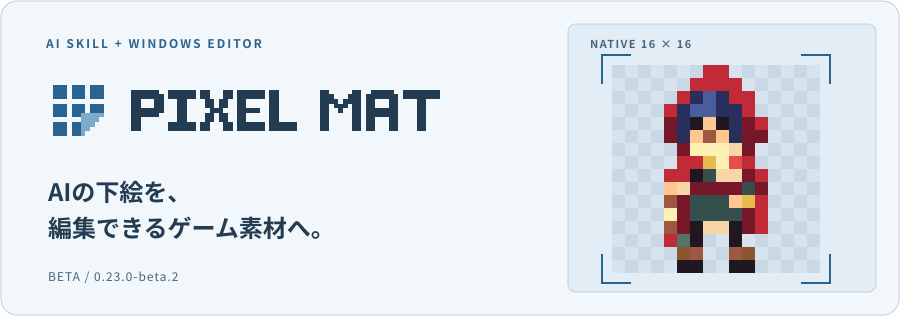
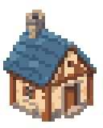
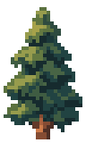
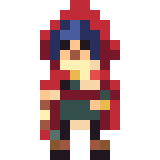
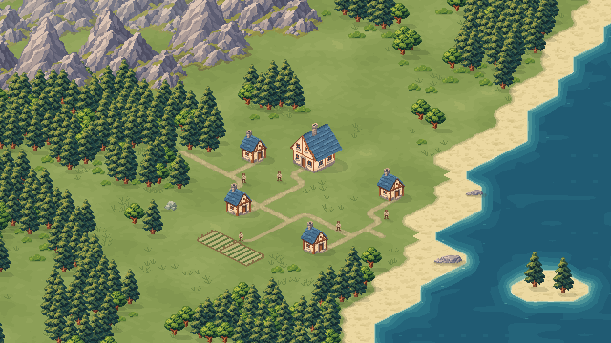

<p align="center"><a href="README.md">English</a> · <a href="README.ko.md">한국어</a> · <strong>日本語</strong></p>

<div align="center">
  <picture>
    <source media="(prefers-color-scheme: dark)" srcset="docs/readme/hero.ja.dark.svg">
    
  </picture>
  <h1>Pixel Mat</h1>
</div>

<p align="center">
  <a href="https://github.com/hjcud/pixel-mat/releases/download/v0.23.0-beta.2/PixelMat-0.23.0-beta.2-win-x64.zip"><strong>Windowsアプリをダウンロード ↓</strong></a>&ensp;·&ensp;
  <a href="https://github.com/hjcud/pixel-mat/releases/download/v0.23.0-beta.2/pixel-mat-skill-0.23.0-beta.2.zip"><strong>AIスキルをダウンロード ↓</strong></a><br>
  <sub><a href="https://github.com/hjcud/pixel-mat/releases/tag/v0.23.0-beta.2">変更内容・チェックサム</a></sub>
</p>

<table align="center">
  <tr>
    <td width="280" align="center"><a href="docs/FEATURES.ja.md#3d形状からベースを作る"><strong>3Dベース</strong></a><br><sub>内蔵形状5種類 → 実サイズのピクセル</sub></td>
    <td width="280" align="center"><a href="docs/FEATURES.ja.md#スプライトアニメーションを作る"><strong>アニメ制作</strong></a><br><sub>フレーム → シート · JSON · APNG</sub></td>
    <td width="280" align="center"><a href="docs/FEATURES.ja.md#つながるタイルを作る"><strong>タイル制作</strong></a><br><sub>繰り返し模様 · Blob-47</sub></td>
  </tr>
</table>

<p align="center"><a href="docs/FEATURES.ja.md"><strong>機能ツアー</strong></a> &ensp;·&ensp; <a href="#クイックスタート">クイックスタート</a> &ensp;·&ensp; <a href="#作業別の依頼例">作業別の依頼</a> &ensp;·&ensp; <a href="#1616の標準生成フロー">生成フロー</a> &ensp;·&ensp; <a href="#ローカル作例を実行">ローカル作例</a></p>

---

## 作った理由

16×16のピクセルアートを頼んでも、大きな画像が返ってきたり、ピクセルの境界や色が
揃わなかったりしました。ゲームには実際のピクセルサイズが決まった素材が必要でした。
生成指示、ローカル変換、エディターをつなぎ、PNGとして使った後も編集を続けられるようにしました。

### 個々の素材からゲームシーンへ

<table align="center">
  <tr>
    <td width="280" align="center"><br><strong>家</strong><br><sub>32×40 · Miniworld</sub></td>
    <td width="280" align="center"><br><strong>針葉樹</strong><br><sub>24×40 · Miniworld</sub></td>
    <td width="280" align="center"><br><strong>キャラクター</strong><br><sub>16×16 · 中央代表色</sub></td>
  </tr>
</table>

家と木はPixel Matスキルで個人ゲーム用に制作し、調整してUnityのテストマップに
配置した素材です。キャラクターは別途採用したWhole-chip central medianの作例です。
上の素材は元のピクセルを変えず、整数倍率で拡大しています。

<p align="center"></p>

*制作した家と木を配置したUnityテストマップ。* 実際のゲームカメラのキャプチャです。
上のキャラクターは別の変換実験の結果です。
[画像の出典と利用範囲](docs/readme/README.md#showcase-artwork)

<details>
<summary><strong>同一プロンプトでのGPT / Pixel Mat比較記録を見る</strong></summary>

両条件に同じ[ユーザープロンプト](docs/whole-comparison/common-prompt.txt)と
[参照画像](docs/whole-comparison/reference.png)を渡し、**実際の16×16ピクセルアートと
透明色を含む最大16色**を明示しました。

<table align="center">
  <tr>
    <th width="420" align="center">通常のGPT画像生成</th>
    <th width="420" align="center">Pixel Matの画像全体の修正</th>
  </tr>
  <tr>
    <td align="center"><br><sub>原画像を縮小表示</sub></td>
    <td align="center"><br><sub>実際の出力を16倍に拡大</sub></td>
  </tr>
  <tr>
    <td align="center"><strong>1254×1254</strong><br><sub>実際の画像サイズ</sub></td>
    <td align="center"><strong>16×16</strong><br><sub>実際の画像サイズ</sub></td>
  </tr>
  <tr>
    <td align="center"><strong>58,266</strong><br><sub>異なるRGBA値</sub></td>
    <td align="center"><strong>16</strong><br><sub>透明色を含むRGBA値</sub></td>
  </tr>
  <tr>
    <td align="center"><strong>PNG</strong><br><sub>画像ファイル</sub></td>
    <td align="center"><strong>PNG + .pixeltool</strong><br><sub>画像 + 編集可能なプロジェクト</sub></td>
  </tr>
</table>

2026-11-22にCodexホストの画像ツールで、それぞれ1回生成しました。Pixel Mat側にはスキル指示と
ローカル変換を加えています。この実験で確認した違いはサイズ・色数・編集可能性です。
顔とランタンの細部は依然として単純化されています。
[原ファイル・比較条件・測定記録](docs/whole-comparison/README.md)

</details>

<details>
<summary><strong>採用した中央代表色の作例と色チップボードを見る</strong></summary>

ヘッダーとキャラクターのギャラリーには、別途採用した以下の生成結果を使用しています。
透明色を含む16色の固定パレットで、上の同一プロンプト実験とは生成プロンプトが異なります。

<table align="center">
  <tr>
    <th width="420" align="center">生成した16×16色チップボード</th>
    <th width="420" align="center">実際の16×16出力</th>
  </tr>
  <tr>
    <td align="center"><br><sub>最終的な256マスの配置をAIで計画</sub></td>
    <td align="center"><br><sub>16倍拡大 · 中央代表色</sub></td>
  </tr>
</table>

[採用ファイルと処理記録](docs/whole-style-recovery/README.md)

</details>

## クイックスタート

**開始前のAI接続確認:** **スキル**はホストのアカウントと利用可能なツールを使います。
**アプリ内AI**にはAPI接続とクレジットを別途設定する必要があり、ホストの契約だけでは
接続されません。手動編集とローカル変換はオフラインで動作します。
[接続ガイド](DATA_HANDLING.md)

| 目的 | 始め方 | 必要な環境 |
| --- | --- | --- |
| AIホストでスプライトを生成・変換 | [スキルを使う](#スキルを使う) | Node 22以上とスキル対応ホスト。新しい画像の生成には画像生成ツールも必要 |
| 既存のPNGやプロジェクトを編集 | [Windowsアプリを使う](#windowsアプリを使う) | Windows x64。手動編集には別途Nodeの導入やAIアカウントは不要 |

### スキルを使う

以下は **WindowsのCodex CLI/IDE** を使う手順です。ランタイムを含む配布ZIPを
使用してください。ソースのスキルフォルダーだけでは実行に必要なコードが足りません。

1. 上の **スキルZIP** をダウンロードして展開します。
2. `pixel-mat`フォルダー全体を`%USERPROFILE%\.agents\skills\pixel-mat`にコピーします。
   この直下に`SKILL.md`があり、`scripts`、`runtime`、`node_modules`が並ぶ状態にします。
   既存のインストールを置き換える場合は先にバックアップしてください。
3. PowerShellでNodeと配布CLIを確認します。

   ```powershell
   node --version
   node "$env:USERPROFILE\.agents\skills\pixel-mat\scripts\pixel-mat.mjs" help
   ```

   Nodeは22以上が必要です。`Pixel Mat:`で始まるコマンド一覧が出ればCLIは動作しています。
   ホストによるスキルの認識は次の手順で別途確認します。
4. Codexの新しいセッションで`/skills`または`$`を使い、`pixel-mat`を探します。
   表示されない場合はフォルダー構成を確認し、Codexを再起動してください。

スキルを選択し、ホストに画像生成ツールがあることを確認して依頼します。

> $pixel-mat
>
> 透明色を含めて最大16色の16×16ランタンアイコンを作ってください。
> `lantern.png`、`lantern.pixeltool`、8倍の拡大画像`lantern-preview.png`として保存してください。

**最初の結果を確認:** `lantern.png`は **16×16**、拡大画像は **128×128**、
`lantern.pixeltool`はPixel Matで16×16のプロジェクトとして開けることを確認します。
実サイズと拡大の両方で形を確認してください。

画像生成ツールがない場合は、下の[ローカル作例](#ローカル作例を実行)でインストールと
変換を確認できます。他のホストやOSでは、それぞれが対応する配置先と呼び出し方法を
使ってください。[セットアップとトラブル対応](skills/pixel-mat/references/getting-started.md) ·
[Codex公式スキルガイド](https://learn.chatgpt.com/docs/build-skills)

### Windowsアプリを使う

1. 上の **アプリZIP** 全体を展開し、`PixelTool-win32-x64\PixelTool.exe`を実行します。
   実行に必要なファイルも一緒に保持してください。署名なしのベータ版です。
2. GitHubの[作例プロジェクト](docs/whole-style-recovery/accepted-median.pixeltool)で
   **Download raw file**を使って保存し、アプリで開きます。16×16のキャラクターです。
   スキルで作成した`lantern.pixeltool`を開いても構いません。
3. 1ピクセルを編集し、**名前を付けて保存**で`edited.pixeltool`を保存してから
   `edited.png`を書き出します。
4. 編集したタブを閉じてから`edited.pixeltool`を開き直し、編集が残っていることを確認します。
   PNGも16×16のままであることを確認し、比較用に元のプロジェクトを保管してください。

<p align="center">
  
</p>

画面は別の32×40のMiniworldの家を開いた日本語UIです。手動編集とファイル操作はオフラインで
動作し、アプリは7つのUI言語に対応しています。
[インストール・更新](BETA_DISTRIBUTION.md) · [エディターガイド](docs/EDITOR_GUIDE.md)

## 作業別の依頼例

ホストでPixel Matを選び、例にある参照画像やプロジェクトを添付してください。

| 作業 | 依頼例 |
| --- | --- |
| 参照画像から生成 | 「添付キャラクターから、透明色を含む最大16色の16×16スプライトを作ってください。フード・前髪・手とランタンの接点を残し、PNGと編集プロジェクトを渡してください。」 |
| ゲームのパレットを再利用 | 「`house.pixeltool`のパレットを使って`tree-draft.png`を24×40に変換し、`tree.png`と`tree.pixeltool`で保存してください。」 |
| 既存スプライトを修正 | 「`character.pixeltool`のランタンだけを既存パレットで明るくしてください。姿勢と他のピクセルを維持し、適用前に修正案を見せてください。」 |
| 採用した結果をアニメーション化 | 「`character.pixeltool`から1フレーム120msの4フレーム待機モーションを作ってください。既存のピクセル・パーツと1つのパレットを再利用し、先に各フレームを見せてください。プロジェクト・スプライトシート・フレームJSON・APNGを渡してください。」 |

正確な格子・パーツ構成には`from-grid` / `from-parts`、限定的な修正には
`review-context` / `refine`、動作計画には`render-motion`を使います。
すべての作業で先に画像生成が必要なわけではありません。
[スキルガイド](skills/pixel-mat/SKILL.md) · [CLIリファレンス](skills/pixel-mat/references/cli.md)

## 16×16の標準生成フロー

1. **残す特徴の配置を計画。** 顔・体・手・小物を最終的な256マスの中で
   まとめて配置するようAIに指示し、色チップボードを生成します。
2. **格子を検査して代表色を取得。** マスの数と整列を確認し、
   各マスの中央領域からRGBそれぞれの中央値を求めます。
3. **背景を分離。** 外周からつながる灰色の空きマスだけを透明にし、
   対象内部の似た色は残します。
4. **パレットに合わせて保存。** 指定パレットや目標の色数に合わせて、
   PNGと編集可能なプロジェクトを保存します。

16×16の標準は **Whole-chip central median（中央代表色）** です。
**領域割り当て**は同じボードに使えるベータ版の選択肢で、他のサイズには通常の
画像変換を使います。アプリとCLIはこの処理を共有します。AI提案は編集保護の条件を
検証してから適用し、1回の操作で元に戻せます。
[生成フローの詳細](skills/pixel-mat/references/whole-image.md)

## ローカル作例を実行

<details>
<summary>画像生成やAPIキーなしで変換を確認</summary>

[色チップボード](docs/whole-style-recovery/accepted-board.png)と
[パレット](docs/whole-style-recovery/palette.json)を **Download raw file**で保存します。
ファイル名は`accepted-board.png`と`palette.json`のままにし、保存した作業フォルダーで
PowerShellを開きます。上のスキル導入後、次のコマンドを実行してください。

```powershell
$pixelMatCli = "$env:USERPROFILE\.agents\skills\pixel-mat\scripts\pixel-mat.mjs"
node $pixelMatCli whole-prepare --input accepted-board.png --width 16 --height 16 --colors 16 --palette palette.json --output example.pixeltool
node $pixelMatCli preview --input example.pixeltool --scale 1 --output example.png
node $pixelMatCli inspect --input example.pixeltool
```

成功すると`example.pixeltool`と16×16の`example.png`ができ、`inspect`に
`width: 16`と`height: 16`が表示されます。プロジェクトをアプリで開いて編集を続けられます。
通常の画像下絵には`whole-prepare`ではなく`prepare`を使います。
同名の出力が既にある場合は、新しいファイル名を指定してください。

</details>

## AI接続と現在の制限

生成には自分のアカウントの利用枠やAPIクレジットを使い、開発者は提供しません。
CLI自体はモデルを呼び出しません。アプリ内の画像全体のAPI生成にはOpenAIを使い、
Codexの項目はCLIの状態確認とスキル・ファイルの受け渡しを案内します。
[接続とデータ処理](DATA_HANDLING.md)

結果は実サイズで確認してください。格子と色数が正しくても、表情や小物の細部が
十分に残らないことがあります。原画像の解析・再構成・レイアウト・サンプリング平面は
実験機能です。採用したボードとパレットを保管してください。再生成は新しい絵になります。
[手法と検証記録](docs/TECHNIQUES.md)

## 開発と貢献

ソースからの実行にはWindows、Node **22.12以上**、pnpmが必要です。

```sh
pnpm install --frozen-lockfile
pnpm start
pnpm test
pnpm build:skill
```

[貢献ガイド](CONTRIBUTING.md)にデスクトップ・配布物の検証方法を記載しています。
自動化したモデル検証ではモックを使用します。
[Issue](https://github.com/hjcud/pixel-mat/issues)は英語でお願いします。

コードとスキル指示は[MITライセンス](LICENSE)です。参照画像とゲーム素材の権利は
[ライセンスの範囲](LICENSE_SCOPE.md)で区別しています。
[セキュリティ](SECURITY.md) · [外部コンポーネント](THIRD_PARTY_NOTICES.md) ·
[翻訳の出典](TRANSLATION_PROVENANCE_REVIEW.md)
