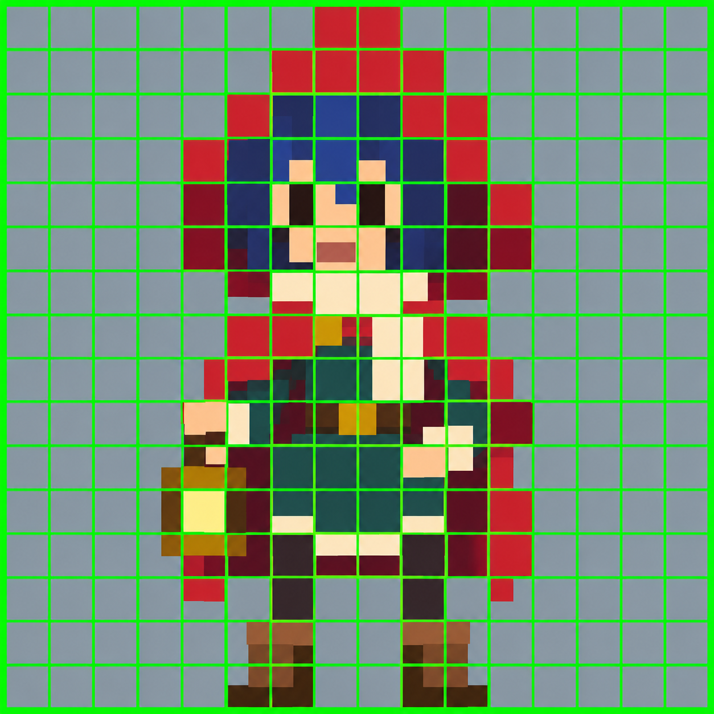
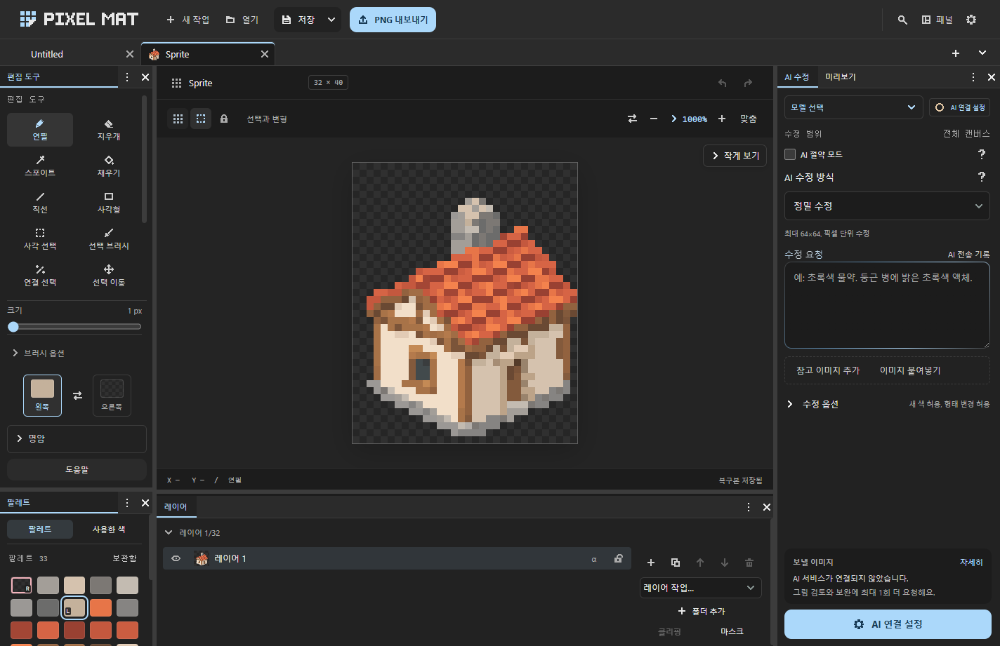

# Pixel Mat

[English](README.md) | [한국어](README.ko.md) | [日本語](README.ja.md)

ゲーム用ピクセルアートの下絵を作るAIスキルと、仕上げ用のWindowsエディターです。
必要なピクセルサイズと色数に変換し、アプリでピクセル・レイヤー・パレットを編集できます。

**Windowsベータ · 0.23.0-beta.2**
[アプリ](https://github.com/hjcud/pixel-mat/releases/download/v0.23.0-beta.2/PixelMat-0.23.0-beta.2-win-x64.zip) ·
[スキル](https://github.com/hjcud/pixel-mat/releases/download/v0.23.0-beta.2/pixel-mat-skill-0.23.0-beta.2.zip) ·
[変更内容・チェックサム](https://github.com/hjcud/pixel-mat/releases/tag/v0.23.0-beta.2) ·
[ポートフォリオの作例](https://hjcud.github.io/#pixel-mat)

## 作った理由

16×16のピクセルアートを頼んでも、大きな画像が返ってきたり、ピクセルの境界や色が
揃わなかったりしました。ゲームには実際のピクセルサイズが決まった素材が必要でした。
生成指示、ローカル変換、エディターをつなぎ、PNGとして使った後も編集を続けられるようにしました。

## 16×16キャラクターの作例

| AIが生成した16×16色チップボード | 実際の16×16出力を16倍に拡大 |
| --- | --- |
|  |  |

以前採用したボードと、透明色を含む16色の固定パレットを使った例です。
現在のアプリとスキルでも同じピクセルを再現できます。
[元のPNG・プロジェクト・再現手順](docs/whole-style-recovery/README.md) ·
[別途保存した同一ユーザープロンプトの比較](docs/whole-comparison/README.md)

### 16×16の標準生成フロー

1. **残す特徴の配置を計画。** 顔・体・手・小物を最終的な256マスの中で
   まとめて配置するようAIに指示し、色チップボードを生成します。
2. **格子を検査して代表色を取得。** ローカルコードで分離したマスの数と整列を
   確認し、各マスの中央領域からRGBそれぞれの中央値を求めます。
3. **背景を分離。** 外周からつながる灰色の空きマスだけを透明にし、
   対象内部の似た色は残します。
4. **パレットに合わせて保存。** 指定パレットに色を合わせるか、設定した色数に
   整理して、実サイズのPNGと編集可能な`.pixeltool`プロジェクトを保存します。

16×16の標準は **Whole-chip central median（中央代表色）** です。
**領域割り当て**は同じボードに使えるベータ版の選択肢で、他のサイズには通常の
画像変換を使います。[生成フローの詳細](skills/pixel-mat/references/whole-image.md)

## 結果を続けて編集



Miniworldの32×40の家を開いたアプリ画面です。ゲーム素材の作例は
[ポートフォリオ](https://hjcud.github.io/#pixel-mat)でも確認できます。

| 作業 | 使用するフロー |
| --- | --- |
| 指示や参照画像から生成 | 画像生成後、色チップまたは通常画像を変換 |
| 正確なピクセルや再利用パーツを設計 | AIが作成した格子・パーツ配置を`from-grid` / `from-parts`で構成 |
| 既存スプライトを修正 | 手動ツール、または選択範囲・パレット・アルファを保護した限定的なAI修正 |
| 採用したスプライトをアニメーション化 | ピクセルパーツと動作計画を再利用し、シート・フレームJSON・APNGを出力 |

AIの提案を確認してから適用し、1回の操作で元に戻せます。
アプリと単独実行CLIはピクセル・パレット・プロジェクトの処理コードを共有しています。

## アプリを使う

1. 上のWindows x64 ZIPをダウンロードし、**フォルダー全体を展開**します。
2. `PixelTool.exe`を実行します。実行に必要なファイルも一緒に保持してください。署名なしのベータ版です。
3. PNGまたは`.pixeltool`を開いて編集し、プロジェクトを保存して実サイズのPNGを書き出します。

手動編集とファイル操作はオフラインで動作し、アプリは7つのUI言語に対応しています。
[インストール・更新](BETA_DISTRIBUTION.md)と[エディターガイド](docs/EDITOR_GUIDE.md)をご覧ください。

## スキルのインストールと使い方

上のスキルZIPにある`pixel-mat`フォルダーを、ランタイムと依存ファイルごと使用します。
AIホストが対応するスキルディレクトリに配置してください。**Node 22以上**が必要です。
Electronや追加パッケージのインストールは不要です。
[インストールと最初の作業](skills/pixel-mat/references/getting-started.md)

画像生成が使えるAIホストに、自然言語で依頼します。

> Pixel Matで16×16の探検家を、透明色を含めて最大16色で作ってください。
> 実サイズと整数倍率の拡大を確認し、PNGと編集用プロジェクトを渡してください。

生成した16×16色チップボードをローカルで変換する場合:

```sh
node /path/to/pixel-mat/scripts/pixel-mat.mjs whole-prepare --input board.png --width 16 --height 16 --colors 16 --output sprite.pixeltool
node /path/to/pixel-mat/scripts/pixel-mat.mjs preview --input sprite.pixeltool --scale 1 --output sprite.png
```

採用済みのパレットを維持するには`--palette existing.pixeltool`を指定します。
通常の画像下絵には`prepare`を使います。他の作業は[スキルガイド](skills/pixel-mat/SKILL.md)と
[CLIリファレンス](skills/pixel-mat/references/cli.md)をご覧ください。

## AI接続と現在の制限

ローカルエディターとCLIにはAIアカウントは不要です。生成には自分のホストアカウント、
サブスクリプションの利用枠、またはAPIクレジットを使用します。開発者はトークンや
クレジットを提供しません。CLI自体はモデルを呼び出しません。

アプリ内のAI接続は別途設定します。画像全体のAPI生成にはOpenAIを使い、ホストの
サブスクリプションがアプリ内API接続になるわけではありません。Codexの項目はCLIの
状態確認とスキル・ファイルの受け渡しを案内します。[接続とデータ処理](DATA_HANDLING.md)

結果は実サイズで確認してください。格子と色数が正しくても、表情や小物の細部が
十分に残らないことがあります。原画像の解析・再構成・レイアウト・サンプリング平面は
実験機能です。採用したボードとパレットを保管してください。再生成は新しい絵になります。
[手法と検証記録](docs/TECHNIQUES.md)

## 開発と貢献

ソースからの実行にはWindows、Node **22.12以上**、pnpmが必要です。

```sh
pnpm install --frozen-lockfile
pnpm start
pnpm test
pnpm build:skill
```

[貢献ガイド](CONTRIBUTING.md)にデスクトップ・配布物の検証方法を記載しています。
自動化したモデル検証ではモックを使用します。
[Issue](https://github.com/hjcud/pixel-mat/issues)は英語でお願いします。

コードとスキル指示は[MITライセンス](LICENSE)です。参照画像とゲーム素材の権利は
[ライセンスの範囲](LICENSE_SCOPE.md)で区別しています。
[セキュリティ](SECURITY.md) · [外部コンポーネント](THIRD_PARTY_NOTICES.md) ·
[翻訳の出典](TRANSLATION_PROVENANCE_REVIEW.md)
