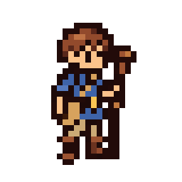

# Pixel Mat

[English](README.md) | [한국어](README.ko.md) | [日本語](README.ja.md)

AIスキルで実際のピクセルサイズの素材を作り、ローカルエディターで仕上げます。
Pixel MatはWindowsアプリ、単独実行できるNode CLI、AIホスト用スキルを
同じリポジトリで提供し、ピクセル・パレット・プロジェクトの処理を共有します。

画像モデルが下書きを作り、ローカルツールが指定サイズ、色数、編集可能な
`.pixeltool`ファイルを生成します。顔・手・小物の細部がすべて残るわけでは
ないため、実寸で確認してください。

**Windowsベータ: 0.23.0-beta.1。** 公開ファイルは
[リリースページ](https://github.com/hjcud/Pixerin/releases)、署名なしフォルダー版の
起動と更新は[ベータの案内](BETA_DISTRIBUTION.md)を参照してください。
今回の候補では韓国語の原文から6言語の翻訳を新たに作成しました。
[翻訳の由来](TRANSLATION_PROVENANCE_REVIEW.md)と
[公開前の確認事項](PUBLICATION_CHECKLIST.md)も記録しています。

## 出力例

| 物体、32×32を8倍表示 | 人物、32×32を8倍表示 |
| --- | --- |
|  |  |

テキストのみで生成した同じ原画像をローカル変換しています。剣は大きな材質の
区別を保ちますが、探検家は顔と手の細部を失います。
[原画像・実寸・プロンプト・限界](docs/COMPARISON.md)も公開しています。
画像ツールの実モデルIDが不明なため、同一GPTを使った統制比較とは呼びません。

[Miniworldの事例](docs/MINIWORLD_CASE_STUDY.md)では住民・木・家の実際の下書きから
ネイティブ変換、位置合わせ、パレット調整、アプリ編集までを示します。原画像と
編集可能な結果、13件のRGBA再現検証を公開し、マップはUnity実行画面ではないオフライン配置例です。

## アプリを使う

検証済みWindows x64ベータフォルダーを受け取ったら、全体を展開して
`PixelTool.exe`を起動します。互換性のため従来の実行ファイル名を維持します。
署名付きインストーラーは含みません。

ソースからの起動にはWindows、Node **22.12以上**、pnpmが必要です。

```sh
pnpm install
pnpm start
```

1. スキルが作ったPNGまたは`.pixeltool`を開きます。
2. アクティブレイヤーを鉛筆・選択範囲・マスク・パレットで編集します。
3. Ctrl+Sで編集可能なプロジェクトを保存し、元の解像度のPNGを書き出します。
4. アニメーションはパネル配置メニューから開き、シート・JSON・APNGを書き出します。

手動編集、ローカル変換、ファイル入出力はオフラインで使えます。アプリの
既存7言語は維持され、READMEの3言語とは別です。

## スキルのインストールと使用

```sh
pnpm build:skill
```

`dist/pixel-mat-skill.zip`内の`pixel-mat`フォルダー全体を使います。
Node **22以上**が必要で、Electronや追加パッケージのインストールは不要です。
[インストールと最初の作業](skills/pixel-mat/references/getting-started.md)で、
ホストが対応する配置先を確認してください。リポジトリのスキル原本フォルダー
だけでは、単独実行用ランタイムは含まれません。

画像を表示できるAIホストには、自然言語で依頼します。

> Pixel Matスキルで32×32、透明色を含め16色以内の探検家を作ってください。
> 実寸と整数倍の拡大を確認し、PNGと編集可能なプロジェクトを渡してください。

これはホストへの依頼で、ターミナルのコマンドではありません。直接変換する場合:

```sh
node /path/to/pixel-mat/scripts/pixel-mat.mjs prepare --input draft.png --output sprite.pixeltool --width 32 --height 32 --colors 16
node /path/to/pixel-mat/scripts/pixel-mat.mjs preview --input sprite.pixeltool --output sprite.png --scale 1
```

正確なインデックス格子には`from-grid`、再利用パーツには`from-parts`、
範囲を限定した修正には`review-context`/`refine`、一貫したフレームには
`render-motion`を使います。[スキル](skills/pixel-mat/SKILL.md)と
[CLI](skills/pixel-mat/references/cli.md)に入出力と拒否された計画の修正方法があります。

## AI接続と費用

AI提案はアクティブレイヤー・選択範囲・パレット・アルファ・マスク・細部保護を
検証してから表示します。適用と取り消しは一括です。Preciseは限定した格子編集、
Wholeは画像下書きとローカル変換です。再変換は追加の生成リクエストを使いません。

アプリ内APIは自分で設定したOpenAI・Claude・Geminiのキーとモデルを使います。
Whole画像生成は現在OpenAI APIに対応します。初期状態では未接続です。
設定 → AIのCodexスキル項目を開くと、公式CLIコマンドでバージョンとログイン状態を
確認し、ホストでのスキル・ファイル受け渡しを案内します。推論の実行や認証ファイルの
抽出は行わず、サブスクリプションのログインをアプリ内画像APIに変換しません。
確認終了はCodexのログアウトではありません。[データの扱い](DATA_HANDLING.md)を参照してください。

ツールとローカルCLIは[MITライセンス](LICENSE)で無料です。AI利用には自分の
アカウント、契約の利用枠、APIクレジットを使います。開発者はトークンや
クレジットを提供しません。ローカルの決定的処理はモデルを呼び出しません。
APIトークン、画像生成料金、ホストの契約利用量を分け、測定できない値はunknownと
記します。節約率は作りません。PixelLabや新しい有料サービスは不要です。

## 通常機能と実験

標準変換は原画像の縦横比、特徴サンプリング、知覚色空間での原画像色の
パレット調整を使い、ディザリングを行いません。Source structureは任意です。
[手法と根拠](docs/TECHNIQUES.md)で標準・任意・研究機能を分けています。
AIによる原画像分析・形状再構成・ホスト作成レイアウト・source planesは実験機能です。
安定した16px人物再現や単色チップ生成の成功は主張しません。好まれた簡潔な
全身比率やシルエットと、原画像の表情再現は別に評価します。

新規キャンバスは一辺3840px、合計8,294,400pxまでで、レイヤーメモリの制限も
適用されます。精密AI編集と自動モーションの範囲はさらに小さく、大画像生成は
実験段階です。静止画v1/v2・アニメーションv3・自動保存・内部識別子を維持します。
Asepriteプロジェクトの読み込みはありません。[編集案内](docs/EDITOR_GUIDE.md)を参照してください。

## 開発と貢献

```sh
pnpm test
pnpm test:desktop
pnpm build
pnpm test:package
pnpm build:skill
```

デスクトップ検証は隔離プロファイルとモックのモデルを使います。合格は技術的な
動作の証拠で、作品品質の承認ではありません。[貢献](CONTRIBUTING.md)、
[Issue](https://github.com/hjcud/Pixerin/issues)、[セキュリティ報告](SECURITY.md)、
[ライセンス範囲と出典](LICENSE_SCOPE.md)、[外部構成要素](THIRD_PARTY_NOTICES.md)を確認してください。
リポジトリへの貢献は英語が基本です。現在の`Pixerin` URLを維持し、将来
`pixel-mat`に変更する場合の[名前変更計画](docs/REPOSITORY_PLAN.md)を用意しています。
