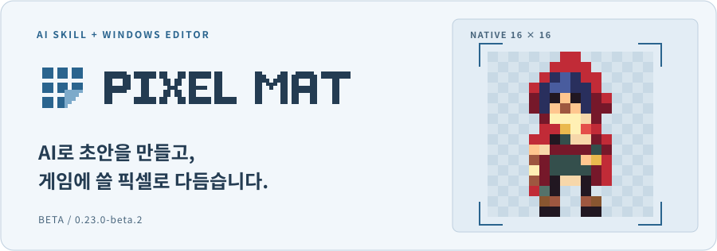
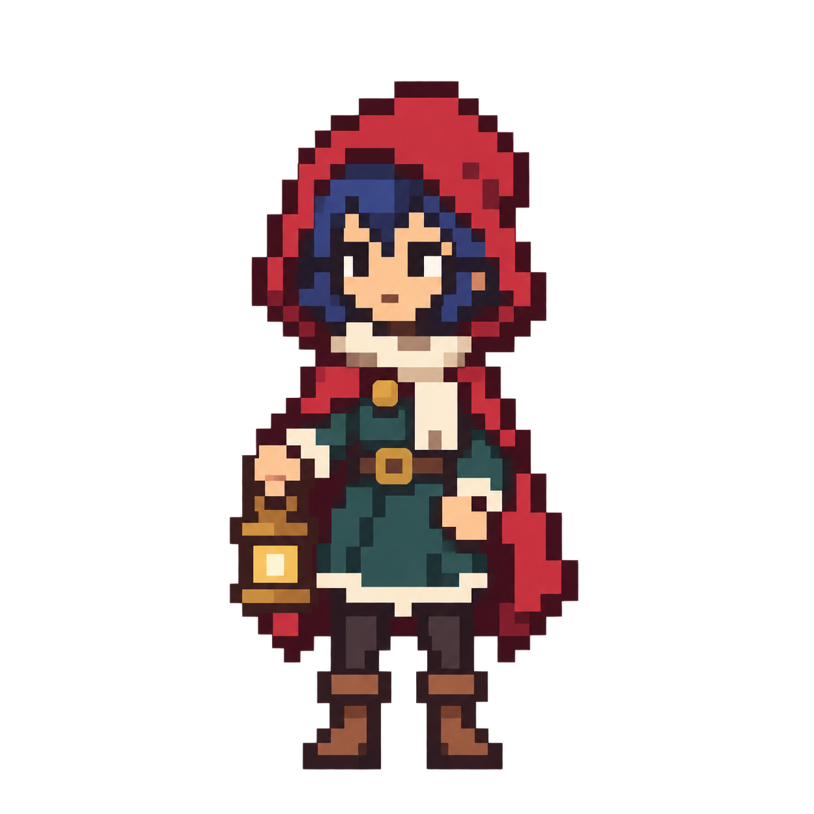
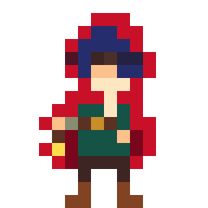
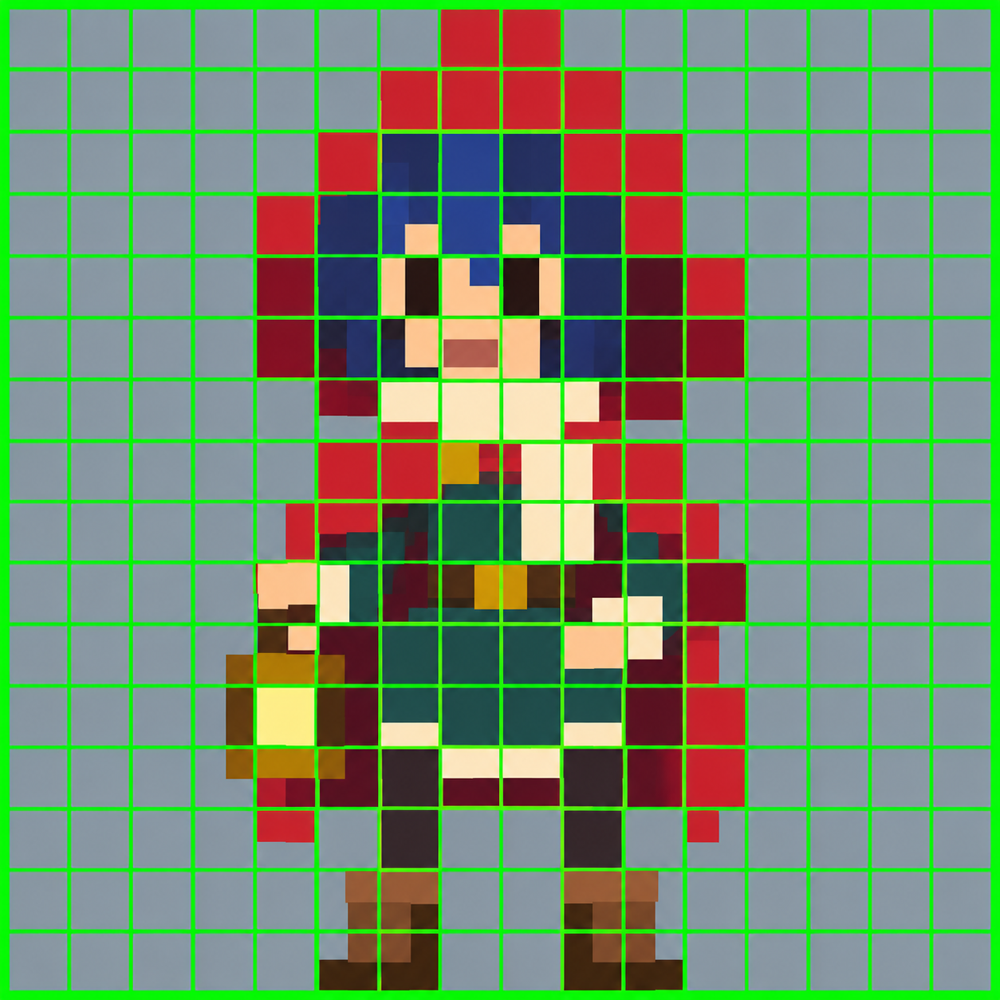
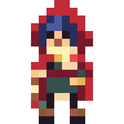
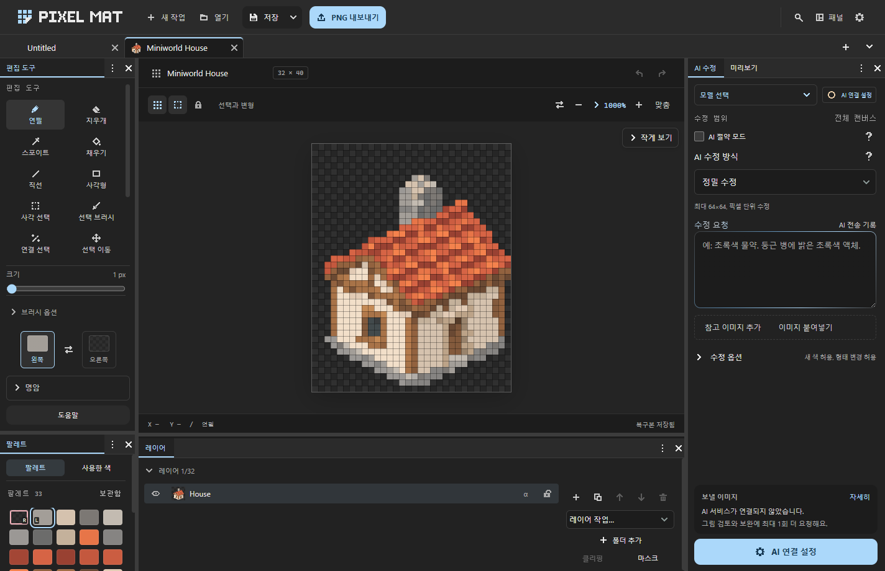

<p align="center"><a href="README.md">English</a> · <strong>한국어</strong> · <a href="README.ja.md">日本語</a></p>

<div align="center">
  <picture>
    <source media="(prefers-color-scheme: dark)" srcset="docs/readme/hero.ko.dark.svg">
    
  </picture>
  <h1>Pixel Mat</h1>
</div>

<p align="center">
  <a href="https://github.com/hjcud/pixel-mat/releases/download/v0.23.0-beta.2/PixelMat-0.23.0-beta.2-win-x64.zip"><strong>Windows 앱 다운로드 ↓</strong></a>&ensp;·&ensp;
  <a href="https://github.com/hjcud/pixel-mat/releases/download/v0.23.0-beta.2/pixel-mat-skill-0.23.0-beta.2.zip"><strong>AI 스킬 다운로드 ↓</strong></a><br>
  <sub><a href="https://github.com/hjcud/pixel-mat/releases/tag/v0.23.0-beta.2">변경 내용·체크섬</a></sub>
</p>

<table align="center">
  <tr>
    <td width="280" align="center"><a href="docs/FEATURES.ko.md#3d-도형으로-베이스-만들기"><strong>3D 베이스</strong></a><br><sub>내장 도형 5종 → 실제 픽셀</sub></td>
    <td width="280" align="center"><a href="docs/FEATURES.ko.md#스프라이트-애니메이션-만들기"><strong>애니메이션</strong></a><br><sub>프레임 → 시트 · JSON · APNG</sub></td>
    <td width="280" align="center"><a href="docs/FEATURES.ko.md#이어지는-타일-만들기"><strong>타일 제작</strong></a><br><sub>반복 무늬 · Blob-47</sub></td>
  </tr>
</table>

<p align="center"><a href="docs/FEATURES.ko.md"><strong>기능 둘러보기</strong></a> &ensp;·&ensp; <a href="#빠른-시작">빠른 시작</a> &ensp;·&ensp; <a href="#작업별-요청-예시">작업별 요청</a> &ensp;·&ensp; <a href="#1616-기본-생성-방식">생성 방식</a> &ensp;·&ensp; <a href="#로컬-예제-실행">로컬 예제</a></p>

---

## 만든 이유

16×16 픽셀 아트를 요청해도 큰 이미지가 나오거나, 픽셀의 경계와 색이 일정하지
않은 경우가 있었습니다. 게임에서는 실제 픽셀 크기에 맞는 리소스가 필요했습니다.
생성 지침과 로컬 변환, 편집기를 연결해 PNG로 쓰고 이후에도 수정할 수 있도록 만들었습니다.

두 조건에 같은 [사용자 프롬프트](docs/whole-comparison/common-prompt.txt)와
[참조 이미지](docs/whole-comparison/reference.png)를 전달하고, 모두 **실제 16×16 픽셀 아트와
투명색 포함 최대 16색**을 명시했습니다.

<table align="center">
  <tr>
    <th width="420" align="center">일반 GPT 이미지 생성</th>
    <th width="420" align="center">Pixel Mat 전체 수정</th>
  </tr>
  <tr>
    <td align="center"><br><sub>원본 이미지를 축소 표시</sub></td>
    <td align="center"><br><sub>실제 출력의 16배 확대</sub></td>
  </tr>
  <tr>
    <td align="center"><strong>1254×1254</strong><br><sub>실제 이미지 크기</sub></td>
    <td align="center"><strong>16×16</strong><br><sub>실제 이미지 크기</sub></td>
  </tr>
  <tr>
    <td align="center"><strong>58,266</strong><br><sub>서로 다른 RGBA 값</sub></td>
    <td align="center"><strong>16</strong><br><sub>투명색을 포함한 RGBA 값</sub></td>
  </tr>
  <tr>
    <td align="center"><strong>PNG</strong><br><sub>이미지 파일</sub></td>
    <td align="center"><strong>PNG + .pixeltool</strong><br><sub>이미지 + 편집 가능한 프로젝트</sub></td>
  </tr>
</table>

2026-11-22에 Codex 호스트의 이미지 도구로 각각 한 번 생성했습니다. Pixel Mat 조건에는 스킬 지침과
로컬 변환이 추가됩니다. 이 실험에서 확인한 차이는 크기·색 수·편집 가능성이며,
얼굴과 랜턴의 세부 표현은 여전히 단순해집니다.
[원본 파일·비교 조건·측정 기록](docs/whole-comparison/README.md)

<details>
<summary><strong>선호한 중앙 대표색 결과와 색칩 보드 보기</strong></summary>

대표 이미지에는 별도로 채택한 아래 생성 결과를 사용했습니다. 투명색 포함 16색 고정
팔레트이며, 위 동일 프롬프트 실험과는 생성 프롬프트가 다릅니다.

<table align="center">
  <tr>
    <th width="420" align="center">생성한 16×16 색칩 보드</th>
    <th width="420" align="center">실제 16×16 결과</th>
  </tr>
  <tr>
    <td align="center"><br><sub>최종 256칸의 배치를 AI로 계획</sub></td>
    <td align="center"><br><sub>16배 확대 · 중앙 대표색</sub></td>
  </tr>
</table>

[채택한 파일·처리 기록](docs/whole-style-recovery/README.md)

</details>

## 빠른 시작

**시작 전 AI 연결 확인:** **스킬**은 호스트 계정과 그 환경의 도구를 사용합니다.
**앱 내부 AI**는 API 연결과 크레딧을 별도로 설정해야 하며, 호스트 구독만으로 연결되지
않습니다. 수동 편집과 로컬 변환은 오프라인으로 작동합니다.
[연결 안내](DATA_HANDLING.md)

| 하고 싶은 작업 | 시작 위치 | 필요한 환경 |
| --- | --- | --- |
| AI 호스트에서 스프라이트 생성·변환 | [스킬 사용](#스킬-사용) | Node 22 이상과 스킬을 지원하는 호스트. 새 이미지 생성에는 이미지 도구도 필요 |
| 기존 PNG나 프로젝트 열기·수정 | [Windows 앱 사용](#windows-앱-사용) | Windows x64. 수동 편집에는 별도 Node 설치나 AI 계정이 필요하지 않음 |

### 스킬 사용

아래는 **Windows의 Codex CLI/IDE** 기준입니다. 런타임이 포함된 배포 ZIP을
사용하세요. 저장소의 스킬 원본 폴더만 복사하면 실행에 필요한 코드가 빠집니다.

1. 위 **스킬 ZIP**을 받아 압축을 풉니다.
2. 전체 `pixel-mat` 폴더를 `%USERPROFILE%\.agents\skills\pixel-mat`에 복사합니다.
   그 안에 `SKILL.md`가 바로 있고, `scripts`, `runtime`, `node_modules`가 함께 있어야
   합니다. 기존 설치가 있다면 먼저 백업하세요.
3. PowerShell에서 Node와 배포 CLI를 확인합니다.

   ```powershell
   node --version
   node "$env:USERPROFILE\.agents\skills\pixel-mat\scripts\pixel-mat.mjs" help
   ```

   Node는 22 이상이어야 합니다. `Pixel Mat:`으로 시작하는 명령 목록이 나오면 CLI는
   실행됩니다. 호스트가 스킬을 찾았는지는 다음 단계에서 별도로 확인합니다.
4. 새 Codex 세션을 열고 `/skills` 또는 `$`로 `pixel-mat`이 목록에 나오는지 확인합니다.
   없다면 폴더 구조를 확인하고 Codex를 다시 시작하세요.

스킬을 선택하고 호스트에 이미지 생성 도구가 있는지 확인한 뒤 요청합니다.

> $pixel-mat
>
> 투명색 포함 최대 16색으로 16×16 랜턴 아이콘을 만들어 줘.
> `lantern.png`, `lantern.pixeltool`, 8배 확대 이미지 `lantern-preview.png`로 저장해 줘.

**첫 결과 확인:** `lantern.png`는 **16×16**, 확대 이미지는 **128×128**이어야 합니다.
`lantern.pixeltool`은 Pixel Mat에서 16×16 프로젝트로 열려야 합니다.
실제 크기와 확대 화면에서 형태를 함께 확인하세요.

이미지 생성 도구가 없다면 아래 [로컬 예제](#로컬-예제-실행)로 설치와 변환을 확인할
수 있습니다. 다른 호스트나 운영체제에서는 해당 환경이 지원하는 설치 위치와 호출
방식을 사용하세요. [설치·문제 해결](skills/pixel-mat/references/getting-started.md) ·
[Codex 공식 스킬 안내](https://learn.chatgpt.com/docs/build-skills)

### Windows 앱 사용

1. 위 **앱 ZIP** 전체를 풀고 `PixelTool-win32-x64\PixelTool.exe`를 실행합니다.
   실행에 필요한 파일을 함께 보관하세요. 서명되지 않은 베타입니다.
2. GitHub의 [예제 프로젝트](docs/whole-style-recovery/accepted-median.pixeltool)에서
   **Download raw file**로 파일을 받아 앱에서 엽니다. 16×16 캐릭터 프로젝트입니다.
   스킬에서 만든 `lantern.pixeltool`을 열어도 됩니다.
3. 픽셀 하나를 수정하고 **다른 이름으로 저장**으로 `edited.pixeltool`을 저장한 뒤
   `edited.png`를 내보냅니다.
4. 수정한 탭을 닫고 `edited.pixeltool`을 다시 열어 수정이 남아 있는지 확인합니다.
   PNG 크기도 16×16이어야 합니다. 비교할 수 있도록 원본 프로젝트를 보관하세요.

<p align="center">
  
</p>

위 화면은 별도의 32×40 Miniworld 집 프로젝트를 연 한국어 UI입니다.
수동 편집과 파일 입출력은 오프라인으로 작동하며, 앱은 7개 UI 언어를 지원합니다.
[설치·업데이트](BETA_DISTRIBUTION.md) · [편집기 안내](docs/EDITOR_GUIDE.md)

## 작업별 요청 예시

호스트에서 Pixel Mat을 선택하고, 예시에 나온 참조 이미지나 프로젝트를 첨부합니다.

| 작업 | 요청 예시 |
| --- | --- |
| 참조 이미지로 생성 | “첨부한 캐릭터로 투명색 포함 최대 16색의 16×16 스프라이트를 만들어 줘. 후드·앞머리·손과 랜턴의 연결을 남기고 PNG와 편집 프로젝트로 전달해 줘.” |
| 게임 팔레트 재사용 | “`house.pixeltool`의 팔레트를 사용해 `tree-draft.png`를 24×40으로 변환하고, `tree.png`와 `tree.pixeltool`로 저장해 줘.” |
| 기존 스프라이트 보정 | “`character.pixeltool`에서 기존 팔레트로 랜턴만 밝게 바꿔 줘. 자세와 나머지 픽셀은 유지하고, 적용 전에 수정안을 보여줘.” |
| 채택한 결과로 애니메이션 | “`character.pixeltool`로 프레임당 120ms인 4프레임 대기 동작을 만들어 줘. 기존 픽셀·부품과 하나의 팔레트를 재사용하고 프레임을 먼저 보여줘. 프로젝트·스프라이트 시트·프레임 JSON·APNG를 전달해 줘.” |

정확한 격자·부품 구성은 `from-grid` / `from-parts`, 제한된 보정은
`review-context` / `refine`, 동작 계획은 `render-motion`을 사용합니다.
모든 작업에 이미지 생성이 먼저 필요한 것은 아닙니다.
[스킬 지침](skills/pixel-mat/SKILL.md) · [CLI 안내](skills/pixel-mat/references/cli.md)

## 16×16 기본 생성 방식

1. **남길 특징의 위치를 계획합니다.** 얼굴·몸·손·소품을 최종 256칸 안에 함께
   배치하도록 AI에 요청하고 색칩 보드를 생성합니다.
2. **격자를 검사하고 대표색을 읽습니다.** 분리된 칸의 개수와 정렬을 확인하고,
   각 칸 중앙 영역의 RGB별 중앙값을 구합니다.
3. **배경을 분리합니다.** 가장자리에서 이어지는 회색 빈칸만 투명하게 바꿔,
   대상 내부에 남겨야 할 비슷한 색은 보존합니다.
4. **팔레트에 맞춰 저장합니다.** 지정한 팔레트나 목표 색 수에 맞춰 PNG와
   편집 가능한 프로젝트를 만듭니다.

16×16의 기본값은 <strong>Whole-chip central median(중앙 대표색)</strong>입니다.
**영역 배정**은 같은 보드에서 선택하는 베타 변환이며, 다른 크기에는 일반 이미지
변환을 사용합니다. 앱과 CLI는 이 처리를 공유합니다. AI 제안은 편집 보호 조건을
검증한 뒤 적용하고 한 번에 실행 취소할 수 있습니다.
[생성 흐름 자세히 보기](skills/pixel-mat/references/whole-image.md)

## 로컬 예제 실행

<details>
<summary>이미지 생성이나 API 키 없이 변환 확인하기</summary>

[색칩 보드](docs/whole-style-recovery/accepted-board.png)와
[팔레트](docs/whole-style-recovery/palette.json)를 **Download raw file**로 받습니다.
파일 이름은 `accepted-board.png`, `palette.json`으로 유지하고, 두 파일을 둔 작업
폴더에서 PowerShell을 엽니다. 위 스킬 설치를 마쳤다면 다음을 실행합니다.

```powershell
$pixelMatCli = "$env:USERPROFILE\.agents\skills\pixel-mat\scripts\pixel-mat.mjs"
node $pixelMatCli whole-prepare --input accepted-board.png --width 16 --height 16 --colors 16 --palette palette.json --output example.pixeltool
node $pixelMatCli preview --input example.pixeltool --scale 1 --output example.png
node $pixelMatCli inspect --input example.pixeltool
```

성공하면 `example.pixeltool`과 16×16 `example.png`가 생기고, `inspect`에
`width: 16`, `height: 16`이 표시됩니다. 프로젝트를 앱에서 열어 편집할 수 있습니다.
일반 이미지 초안에는 `whole-prepare` 대신 `prepare`를 사용합니다.
같은 이름의 출력이 이미 있다면 새 파일 이름을 지정하세요.

</details>

## AI 연결·현재 한계

생성에는 본인 계정의 사용 한도나 API 크레딧이 쓰이며, 개발자가 이를 제공하지
않습니다. CLI 자체는 모델을 호출하지 않습니다. 앱의 전체 이미지 API 생성은 OpenAI를
사용하며, Codex 항목은 CLI 상태 확인과 스킬·파일 전달을 안내합니다.
[연결·데이터 처리](DATA_HANDLING.md)

결과는 실제 크기에서 확인하세요. 격자와 색 수가 맞아도 표정이나 작은 소품이
충분히 남지 않을 수 있습니다. 원본 분석·재구성·레이아웃·샘플링 평면은 실험
기능입니다. 채택한 보드와 팔레트를 보존하세요. 새로 생성하면 다른 그림이 나옵니다.
[기법과 검증 기록](docs/TECHNIQUES.md)

## 개발·기여

소스 실행에는 Windows, Node **22.12 이상**, pnpm이 필요합니다.

```sh
pnpm install --frozen-lockfile
pnpm start
pnpm test
pnpm build:skill
```

필요한 데스크톱·배포 검사는 [기여 안내](CONTRIBUTING.md)를 따릅니다.
자동화된 모델 검사는 모의 응답을 사용합니다.
[이슈](https://github.com/hjcud/pixel-mat/issues)는 영어로 작성해 주세요.

코드와 스킬 지침은 [MIT 라이선스](LICENSE)로 제공합니다. 참조 이미지와 게임
리소스의 사용 조건은 [라이선스 범위](LICENSE_SCOPE.md)에서 구분합니다.
[보안 신고](SECURITY.md) · [외부 구성요소](THIRD_PARTY_NOTICES.md) ·
[번역 출처](TRANSLATION_PROVENANCE_REVIEW.md)
