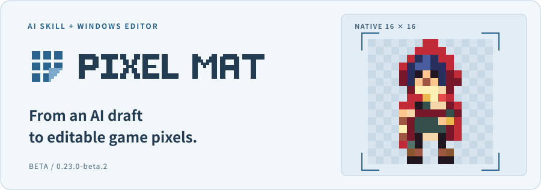
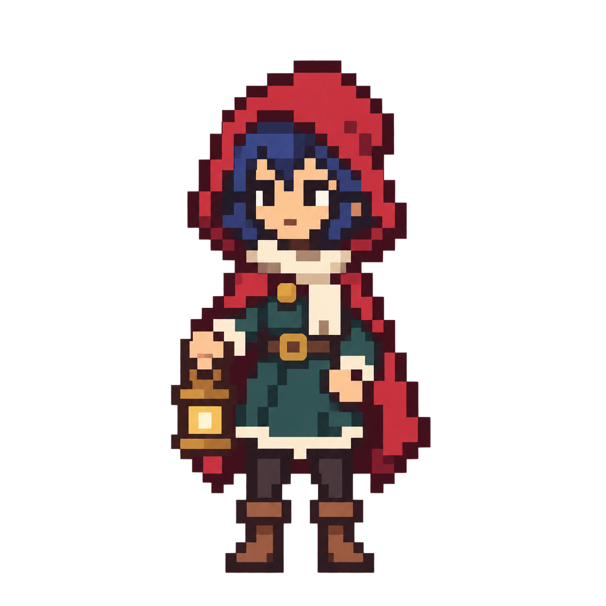
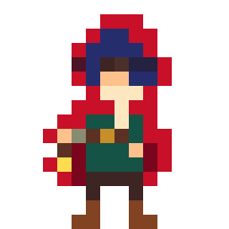
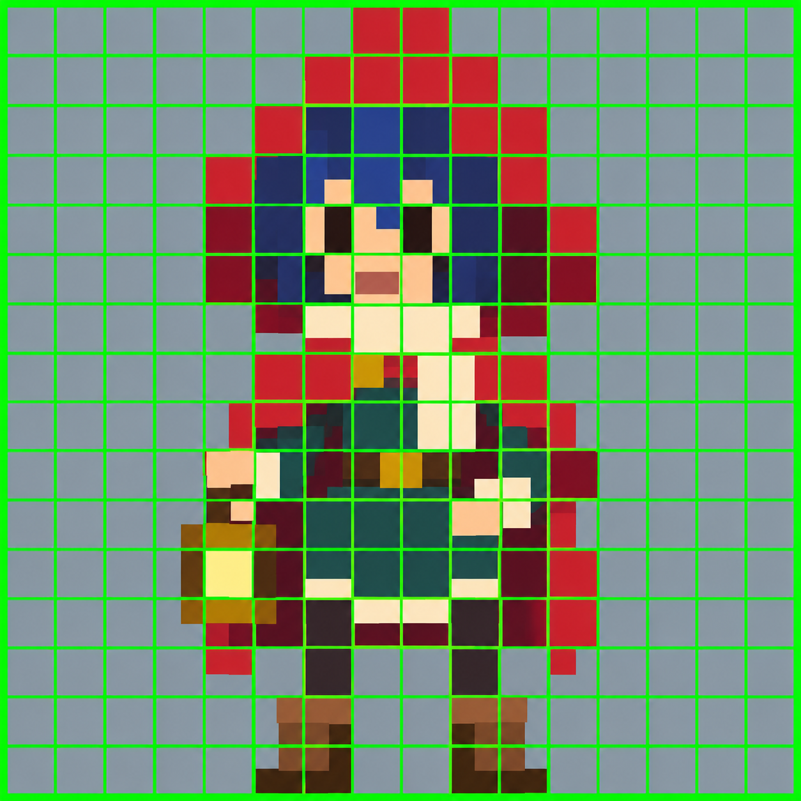
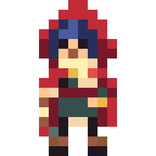
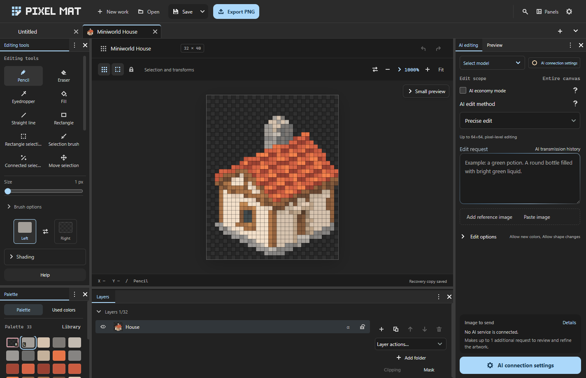

<p align="center"><strong>English</strong> · <a href="README.ko.md">한국어</a> · <a href="README.ja.md">日本語</a></p>

<div align="center">
  <picture>
    <source media="(prefers-color-scheme: dark)" srcset="docs/readme/hero.en.dark.svg">
    
  </picture>
  <h1>Pixel Mat</h1>
</div>

<p align="center">
  <a href="https://github.com/hjcud/pixel-mat/releases/download/v0.23.0-beta.2/PixelMat-0.23.0-beta.2-win-x64.zip"><strong>Download Windows app ↓</strong></a>&ensp;·&ensp;
  <a href="https://github.com/hjcud/pixel-mat/releases/download/v0.23.0-beta.2/pixel-mat-skill-0.23.0-beta.2.zip"><strong>Download AI skill ↓</strong></a><br>
  <sub><a href="https://github.com/hjcud/pixel-mat/releases/tag/v0.23.0-beta.2">Release notes &amp; checksums</a></sub>
</p>

<table align="center">
  <tr>
    <td width="280" align="center"><a href="docs/FEATURES.md#start-with-a-3d-shape"><strong>3D shape bases</strong></a><br><sub>Five built-in shapes → native pixels</sub></td>
    <td width="280" align="center"><a href="docs/FEATURES.md#assemble-a-sprite-animation"><strong>Sprite animation</strong></a><br><sub>Frames → sheets · JSON · APNG</sub></td>
    <td width="280" align="center"><a href="docs/FEATURES.md#build-connected-tiles"><strong>Tiles and autotiles</strong></a><br><sub>Repeating textures · Blob-47</sub></td>
  </tr>
</table>

<p align="center"><a href="docs/FEATURES.md"><strong>Feature tour</strong></a> &ensp;·&ensp; <a href="#quick-start">Quick start</a> &ensp;·&ensp; <a href="#requests-by-task">Requests by task</a> &ensp;·&ensp; <a href="#how-the-default-1616-workflow-works">How it works</a> &ensp;·&ensp; <a href="#try-the-local-example">Local example</a></p>

---

## Why I built it

Asking for 16×16 pixel art can still return a large image with soft or inconsistent
pixel boundaries. I needed assets with actual pixel dimensions for my game.
Pixel Mat connects generation instructions, local pixel conversion and an editor
so a draft can become a PNG and a project I can keep working on.

Both conditions received the same [user prompt](docs/whole-comparison/common-prompt.txt)
and [reference](docs/whole-comparison/reference.png), explicitly asking for
**native 16×16 pixel art and at most 16 colors including transparency**.

<table align="center">
  <tr>
    <th width="420" align="center">Ordinary GPT image request</th>
    <th width="420" align="center">Pixel Mat whole-image workflow</th>
  </tr>
  <tr>
    <td align="center"><br><sub>Original image, displayed smaller</sub></td>
    <td align="center"><br><sub>Native output enlarged 16×</sub></td>
  </tr>
  <tr>
    <td align="center"><strong>1254×1254</strong><br><sub>Actual image dimensions</sub></td>
    <td align="center"><strong>16×16</strong><br><sub>Actual image dimensions</sub></td>
  </tr>
  <tr>
    <td align="center"><strong>58,266</strong><br><sub>Distinct RGBA values</sub></td>
    <td align="center"><strong>16</strong><br><sub>RGBA values, including transparency</sub></td>
  </tr>
  <tr>
    <td align="center"><strong>PNG</strong><br><sub>Image file</sub></td>
    <td align="center"><strong>PNG + .pixeltool</strong><br><sub>Image + editable project</sub></td>
  </tr>
</table>

Recorded on 2026-11-22: both were generated once through the Codex host image tool. Pixel Mat adds
its skill instructions and local conversion. This retained experiment demonstrates
output size, palette limits and editability; face and lantern detail still simplify.
[Original files, conditions and measurements](docs/whole-comparison/README.md)

<details>
<summary><strong>Preferred central-median example and its chip board</strong></summary>

The header uses this separate accepted generation with a fixed 16-entry palette,
including transparency. Its prompt differs from the comparison above.

<table align="center">
  <tr>
    <th width="420" align="center">Generated 16×16 chip board</th>
    <th width="420" align="center">Native 16×16 result</th>
  </tr>
  <tr>
    <td align="center"><br><sub>AI plans the final 256 cells</sub></td>
    <td align="center"><br><sub>Enlarged 16× · central median</sub></td>
  </tr>
</table>

[Accepted files and processing record](docs/whole-style-recovery/README.md)

</details>

## Quick start

**AI access before you start:** The **skill** uses your host account and available
tools. **In-app AI** needs a separately configured API connection and credits;
a host subscription does not supply them. Manual editing and local conversion
work offline. [Connection guide](DATA_HANDLING.md)

| I want to… | Start here | Requirements |
| --- | --- | --- |
| Generate or transform a sprite with an AI host | [Use the skill](#use-the-skill) | Node 22+ and a skill-capable host; new image generation also needs an image tool |
| Open and edit an existing PNG or project | [Use the Windows app](#use-the-windows-app) | Windows x64; no separate Node install or AI account for manual editing |

### Use the skill

The walkthrough below uses **Codex CLI/IDE on Windows**. Keep the complete built
skill ZIP: the source skill folder alone does not include its runtime.

1. Download the **skill ZIP** above and extract it.
2. Copy its complete `pixel-mat` folder to `%USERPROFILE%\.agents\skills\pixel-mat`.
   `SKILL.md` must be directly inside that folder, beside `scripts`, `runtime` and
   `node_modules`. Back up an existing installation before replacing it.
3. In PowerShell, check Node and the bundled CLI:

   ```powershell
   node --version
   node "$env:USERPROFILE\.agents\skills\pixel-mat\scripts\pixel-mat.mjs" help
   ```

   Node must be 22 or newer. A command list beginning with `Pixel Mat:` confirms
   the CLI runs; it does not yet confirm that the AI host discovered the skill.
4. Open a new Codex session and use `/skills` or type `$` to find `pixel-mat`.
   If it is missing, check the folder layout and restart Codex.

Select the skill, confirm that your host has an image-generation tool, and ask:

> $pixel-mat
>
> Create a 16×16 lantern icon with at most 16 colors including transparency.
> Save `lantern.png`, `lantern.pixeltool`, and an 8× preview as `lantern-preview.png`.

**Check the first result:** `lantern.png` should be **16×16**, the preview
**128×128**, and `lantern.pixeltool` should open in Pixel Mat as a 16×16 project.
Inspect the native image as well as the enlargement.

If image generation is unavailable, use the [local example](#try-the-local-example)
below. For another host or operating system, use its supported skill directory
and invocation method. [Host setup and troubleshooting](skills/pixel-mat/references/getting-started.md) ·
[Official Codex skill discovery guide](https://learn.chatgpt.com/docs/build-skills)

### Use the Windows app

1. Download the **app ZIP** above, extract the complete folder, and run
   `PixelTool-win32-x64\PixelTool.exe`. Keep its runtime files together. The beta is unsigned.
2. On GitHub, download this [sample project](docs/whole-style-recovery/accepted-median.pixeltool)
   using **Download raw file**, then open it in Pixel Mat. It is a 16×16 character.
   You can also open `lantern.pixeltool` from the skill walkthrough.
3. Change a pixel, use **Save as** to save `edited.pixeltool`, and export `edited.png`.
4. Close the edited tab, reopen `edited.pixeltool`, and check that the edit remains.
   The exported PNG should still be 16×16. Keep the original project for comparison.

<p align="center">
  
</p>

The English interface with a separate 32×40 Miniworld house project. Manual
editing and file operations work offline; the app supports seven UI languages.
[Installation and updates](BETA_DISTRIBUTION.md) · [Editor guide](docs/EDITOR_GUIDE.md)

## Requests by task

Select Pixel Mat in your host and attach the named reference or project files.

| Task | Example request |
| --- | --- |
| Generate from a reference | “Use the attached character reference to make a 16×16 sprite with at most 16 colors including transparency. Keep the hood, fringe and hand-to-lantern contact. Deliver the PNG and editable project.” |
| Reuse a game's palette | “Convert `tree-draft.png` to 24×40 using the palette from `house.pixeltool`. Save `tree.png` and `tree.pixeltool`.” |
| Refine an existing sprite | “In `character.pixeltool`, brighten only the lantern using the existing palette. Keep the pose and all other pixels. Show the proposed edit before applying it.” |
| Animate an accepted sprite | “Make a four-frame idle animation from `character.pixeltool`, at 120 ms per frame. Reuse the accepted pixels and parts, keep one palette, and show the frames for review. Deliver the project, sprite sheet, frame JSON and APNG.” |

Exact grids and reusable parts use `from-grid` / `from-parts`; bounded repairs
use `review-context` / `refine`; motion plans use `render-motion`. The image
workflow is one route, not a prerequisite for every task.
[Skill guide](skills/pixel-mat/SKILL.md) · [CLI reference](skills/pixel-mat/references/cli.md)

## How the default 16×16 workflow works

1. **Plan the pixel allocation.** Ask the AI to place the face, body, hands and
   props together within the final 256 cells, then generate a chip board.
2. **Check the grid and read colors.** Find separated chips, validate their count
   and alignment, and read each chip's central RGB medians.
3. **Separate the background.** Make only outside-connected empty gray cells
   transparent, keeping enclosed matching colors in the subject.
4. **Match the palette and save.** Use a supplied palette or fit the requested
   color limit; save the PNG and editable project.

At 16×16, **Whole-chip central median** is the default. **Region allocation** is
an optional beta projection of the same board. Other sizes use standard raster
conversion. The app and CLI share these routines; AI proposals are checked
against edit protections before application, with one-step undo.
[Workflow details](skills/pixel-mat/references/whole-image.md)

## Try the local example

<details>
<summary>Verify conversion without image generation or an API key</summary>

Download the [chip board](docs/whole-style-recovery/accepted-board.png) and
[palette](docs/whole-style-recovery/palette.json) using **Download raw file**.
Keep the names `accepted-board.png` and `palette.json`, and open PowerShell in
that work folder. After the skill installation above, run:

```powershell
$pixelMatCli = "$env:USERPROFILE\.agents\skills\pixel-mat\scripts\pixel-mat.mjs"
node $pixelMatCli whole-prepare --input accepted-board.png --width 16 --height 16 --colors 16 --palette palette.json --output example.pixeltool
node $pixelMatCli preview --input example.pixeltool --scale 1 --output example.png
node $pixelMatCli inspect --input example.pixeltool
```

Success produces `example.pixeltool` and a 16×16 `example.png`; `inspect` reports
`width: 16` and `height: 16`. Open the project in the app to continue editing.
For a regular image draft, use `prepare` instead of `whole-prepare`.
If an output already exists, choose a new filename.

</details>

## AI access and current limits

Generation uses your own account allowance or API credits; the developer supplies
neither. The CLI itself makes no model requests. In-app whole-image API generation
uses OpenAI; the Codex section provides CLI status inspection and a skill/file
handoff. [Connection and data handling](DATA_HANDLING.md)

Review the result at its native size. A valid grid and palette do not guarantee
facial expression or small prop detail. Source analysis, reconstruction, layouts
and sampling planes remain experimental. Keep accepted boards and palettes:
another generation is a new drawing. [Methods and evidence](docs/TECHNIQUES.md)

## Develop and contribute

From source on Windows, use Node **22.12+** and pnpm:

```sh
pnpm install --frozen-lockfile
pnpm start
pnpm test
pnpm build:skill
```

[Contributing](CONTRIBUTING.md) covers the focused desktop and package checks;
automated model checks use mocks. Open [issues](https://github.com/hjcud/pixel-mat/issues)
in English.

Code and skill instructions are [MIT licensed](LICENSE). Reference and game
artwork have a separate [license scope](LICENSE_SCOPE.md).
[Security](SECURITY.md) · [Third-party notices](THIRD_PARTY_NOTICES.md) ·
[Translation provenance](TRANSLATION_PROVENANCE_REVIEW.md)
