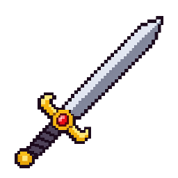
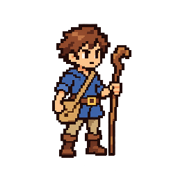
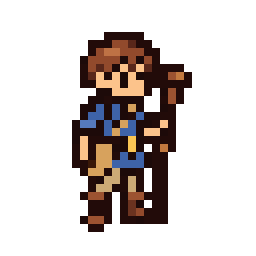
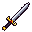

# Image generation and native conversion

[English README](../README.md) | [Side-by-side and 1× views](comparison/index.html)

This compares a host image tool's raw result with **that exact image** converted
by the Pixel Mat skill. Both stages originate from the same prompt, rather than
different prompts chosen to favor one side. It isolates the local grid/palette
step; it does not compare two independently prompted agents or establish that
the complete skill outperforms GPT. The built-in tool did not expose its model
ID or seed, so a controlled same-GPT claim would be unsupported.

## Protocol

The retained study generated two independent samples each of sword, potion,
mushroom and explorer on 2026-11-17. This compact presentation takes the **first
recorded sword and explorer samples**, covering one object and one character.
It does not select the strongest of the two draws. Both were text-only requests,
with no user artwork or visual reference. No new generation was made for this
documentation. The exact prompts and file hashes are in
[provenance.json](comparison/provenance.json).

| Condition | Raw host image | Pixel Mat skill output |
| --- | --- | --- |
| Requested image | Native 32×32, ≤16 colors including transparency | Same target |
| Actual image | 1254×1254 in both cases | Exactly 32×32 |
| RGBA colors, sword / explorer | 36,611 / 46,106 | 16 / 16 |
| Partial-alpha pixels, sword / explorer | 257,296 / 335,610 | 0 / 0 |
| Image requests | One per source, two shown in total | Zero additional requests |
| Local postprocessing | None for the retained source | Feature sampler, frame fit, alpha threshold 128, perceptual palette fit, no dithering |
| Manual pixel repairs in the shown output | None | None |
| Image model / seed | Unknown / unknown | No model used by converter |
| Image cost, host reasoning tokens | Unknown | Local processing uses no model tokens; prior host work remains unmeasured |

The historical host review suggested seven-pixel explorer repairs, then rejected
them after rendering because eye highlights became unnatural. The displayed
explorer is the automatic conversion; no rejected patch is silently included.
Reported request counts do not measure all historical reasoning or monetary cost.

## At the same display size

Each column is 256×256 display pixels. Raw sources are fitted down from 1254px;
native assets use exact 8× nearest-pixel enlargement. A raw source displayed small
is still a 1254px image, not a valid 32px sprite.

| Subject | Raw generation | Local skill conversion |
| --- | --- | --- |
| Sword |  |  |
| Explorer |  |  |

Native 1× outputs: 
.
Inspect full-resolution originals at 1× in the
[comparison viewer](comparison/index.html), or open
[sword source](comparison/sword-source.png) and
[explorer source](comparison/explorer-source.png) directly.
Editable files: [sword](comparison/sword.pixeltool),
[explorer](comparison/explorer.pixeltool).

## What the examples establish

The sword retains a diagonal silhouette and the distinction between metal,
gold and grip, while gem and highlight details simplify. The explorer retains
broad hair/clothing/boot masses and staff placement but loses the readable face
and hand structure requested in the prompt. The polished large source contains
more detail than the final grid can represent. Conversion produces a constrained,
editable native asset; it does not automatically improve every artistic property.

These are two familiar samples, an unverified image model and a non-blinded host
review. They are not a statistical quality benchmark or proof of reliable 16px
character reconstruction. Broader unseen-source stability remains unestablished.

The user's separately retained `median16` and `structure16` whole-chip characters
are compact styles they liked, without a specified preference order. That feedback
does not approve source-expression fidelity, all chip-generation methods or game
integration. Their original user-reference artwork is kept in local research
artifacts rather than copied into this public example set.

## Reproduce and verify

Build the standalone skill, then run for either case:

```sh
node dist/skills/pixel-mat/scripts/pixel-mat.mjs prepare --input docs/comparison/sword-source.png --output /your/work/sword.pixeltool --width 32 --height 32 --colors 16
node dist/skills/pixel-mat/scripts/pixel-mat.mjs preview --input /your/work/sword.pixeltool --output /your/work/sword.png --scale 1
```

The documentation build on 2026-11-22 ran these actual CLI commands and verified
native raster parity with the retained automatic outputs. `node docs/comparison/build.mjs`
rebuilds the display images and verifies the public fixtures. Optional
`--from-study` also verifies the retained local study's native pixel parity when
that research directory is available. The check verifies source/native hashes,
source color/alpha counts, exact 32×32 dimensions, ≤16 RGBA colors and binary alpha. No model call,
credential, local profile or private path is included in the public ledger.
