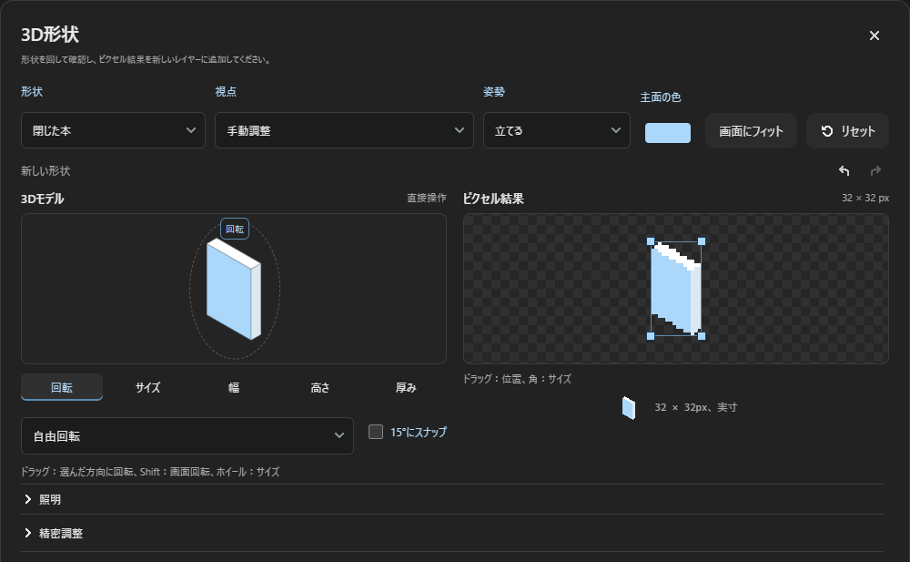
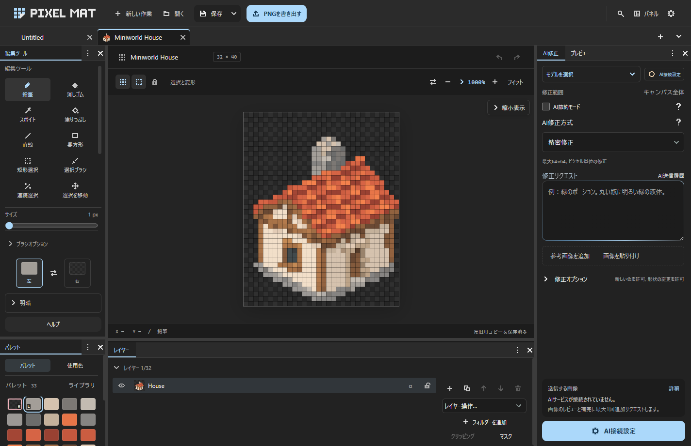
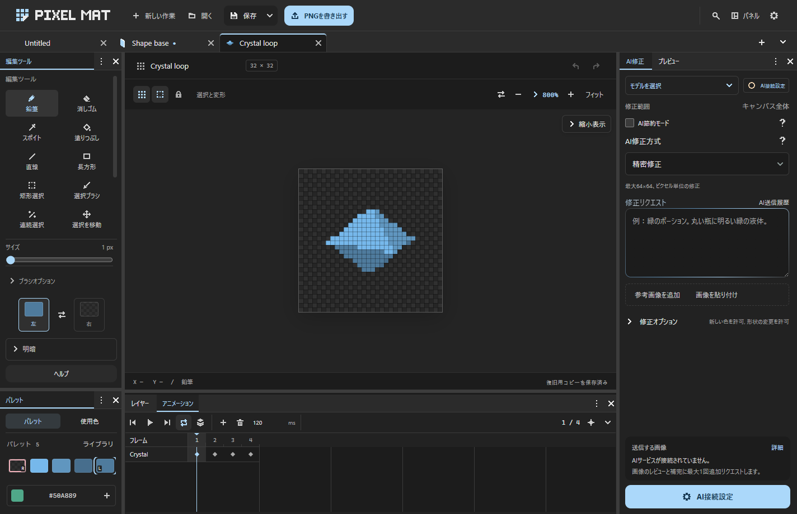
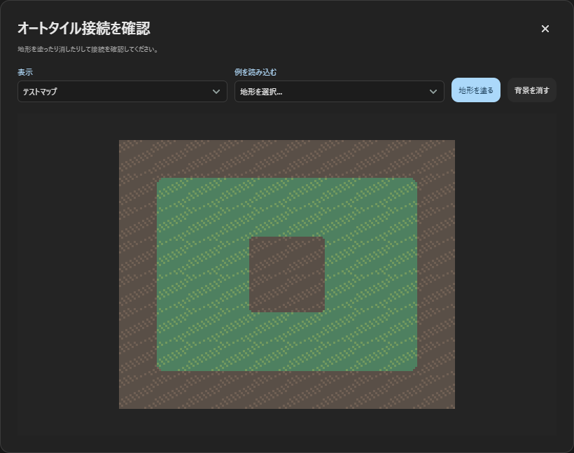

<a href="FEATURES.md">English</a> · <a href="FEATURES.ko.md">한국어</a> · <strong>日本語</strong>

<h1 align="center">Pixel Mat 機能ツアー</h1>

<strong>形状、下絵、既存のスプライトから始めましょう。 ベースを作り、ピクセルを仕上げ、ゲーム素材として書き出します。</strong>

Windowsベータ · 0.23.0-beta.2 · AIスキル + ピクセルエディター

<a href="../README.ja.md#クイックスタート"><strong>導入して最初の結果を作る →</strong></a> &ensp;·&ensp; <a href="https://github.com/hjcud/pixel-mat/releases/tag/v0.23.0-beta.2">ベータをダウンロード</a> &ensp;·&ensp; <a href="EDITOR_GUIDE.md">エディターガイド</a>

<table align="center">
  <tr>
    <td width="420"><a href="#3d形状からベースを作る"><strong>3D形状のベース</strong></a> 形状と視点を決め、実サイズのピクセルベースを作ります。</td>
    <td width="420"><a href="#ピクセルを描いて整理する"><strong>描画とレイヤー</strong></a> 選択・パレット・編集保護で作品を仕上げます。</td>
  </tr>
  <tr>
    <td><a href="#確認して適用するai修正"><strong>AIによる調整</strong></a> 参照を渡し、修正案を比べて適用する結果を選びます。</td>
    <td><a href="#スプライトアニメーションを作る"><strong>スプライトアニメーション</strong></a> フレームと時間を編集し、シート・JSON・APNGに書き出します。</td>
  </tr>
  <tr>
    <td><a href="#つながるタイルを作る"><strong>反復タイルとオートタイル</strong></a> 繰り返し模様を確認し、Blob-47の地形接続を構成します。</td>
    <td><a href="#作業に合わせて画面を構成する"><strong>柔軟なワークスペース</strong></a> タブやパネルを移動し、パレットを再利用して作業を復旧します。</td>
  </tr>
</table>

## 3D形状からベースを作る

本、箱、屋根のような三角柱、ピラミッド、宝石の基本形を決めてから細部を描けます。
モデルを回転し、幅・高さ・厚みを調整しながら、目標キャンバスのピクセル結果を
確認してください。形状のベースはローカルで生成されます。

1. 編集ツールの **3D形状** を開き、5種類の内蔵形状から選びます。
2. 視点を選ぶかモデルをドラッグし、寸法・主面色・任意の照明を調整します。
3. 結果を新しいレイヤーに追加し、許可された面の内側を描き込みます。

ガイドは形状のパラメーターと面の境界を保持します。操作画面を開き直して角度や
比率を変えられます。自由に描画したりフレームアニメーションにする場合はガイドを
解除してください。形状生成は **各辺8–64ピクセル** のキャンバスに対応します。

[32×32の形状プロジェクトを開く](product/examples/shapes.pixeltool) ·
[実サイズPNG](product/examples/shapes.png) · [操作手順](EDITOR_GUIDE.md#3d-shape-bases)

GitHubの **Download raw file** で保存し、`.pixeltool`をPixel Matで開いてください。

## ピクセルを描いて整理する

生成したベースを仕上げたり、最初から描いたりできます。鉛筆、塗りつぶし、線、
図形と、矩形・楕円・なげなわ・多角形・連続選択を使います。グループ、レイヤー
マスク、クリッピング、透明ロックで編集箇所を絞り、整数倍率で描きながら実サイズ
プレビューも確認できます。

プロジェクトのパレットを再利用し、パレットライブラリに色を取り込めます。
レイヤーと編集状態は`.pixeltool`に保存し、完成したピクセルはPNGで書き出します。
上の家は別のMiniworld作例です。[編集とファイル操作](EDITOR_GUIDE.md#open-edit-and-export)

## 確認して適用するAI修正

AIホスト内でスキルを使うか、アプリにAPI接続を設定します。参照画像は送信前に
確認して切り抜けます。アプリでは目標解像度の修正案を比較し、適用するか破棄します。

| 作業 | 動作 |
| --- | --- |
| 精密修正 | 最大64×64の範囲内にある編集可能なピクセルを元の格子で編集します。 |
| 画像全体の修正 | 画像の下絵を生成し、ローカルで変換します。16×16の標準は中央代表色で、領域割り当ては選択できるベータ方式です。 |
| ローカル再変換 | 保持した下絵の色・透明度変換を調整します。画像生成を再度依頼する必要はありません。 |

アクティブレイヤー、選択、パレット、透明ロック、マスク、細部保護が変更範囲を制限します。
適用した案は1回の操作で元に戻せます。送信する参照情報には周囲や他の表示ピクセルも
含まれることがあるため、[接続とデータ処理](../DATA_HANDLING.md)を確認してください。

> 既存のパレットでランタンだけを明るくしてください。姿勢と他のピクセルを維持し、適用前に修正案を見せてください。

ローカルツールはオフラインで動作します。AI生成には自分のホストの利用枠やAPIクレジットを
使用し、ホスト契約とアプリ内API接続は別に設定します。
[スキルのクイックスタート](../README.ja.md#スキルを使う) · [記録済みの結果比較](whole-comparison/README.md)

## スプライトアニメーションを作る

フレームを複製・追加し、各セルを編集して再生時間を変え、ループ再生できます。
オニオンスキンで隣のフレームを比較し、タイムラインでフレームごとのレイヤーと
画像を管理します。対応するAI接続が設定されていれば、確認工程を含むネイティブな
動作計画も依頼できます。

この作例は **ローカルで構成した4フレームのループ** です。AIの出力品質を示す
サンプルではありません。ファイルを開き、速度や画像を変えてみてください。
アニメーション出力にはPNGシート、フレーム位置・時間のJSON、APNGプレビューが含まれます。

[編集可能なクリップ](product/examples/crystal/project.pixeltool) ·
[スプライトシート](product/examples/crystal/sheet-1.png) ·
[フレームJSON](product/examples/crystal/spritesheet.json) ·
[APNG](product/examples/crystal/preview.apng) · [アニメーションガイド](EDITOR_GUIDE.md#animation)

## つながるタイルを作る

反復タイルのプレビューで向かい合う端を確認できます。接続する地形は、内部・上下境界・
左右境界・外側の角・内側の角の5種類の原型を編集し、**Blobの47種類と背景タイル1種類**
として組み合わさる様子を確認します。

確認画面でテストマップを描いたり消したりし、アトラス表示へ切り替えます。
共有する境界を保護しながら、編集可能な原型の細部が接続タイルへ反映されます。
この作例にはローカルで作った単純な手続き型テクスチャを使っています。

[編集可能なタイルセット](product/examples/tiles.pixeltool) ·
[128×96アトラス](product/examples/tiles.png) · [タイル情報](product/examples/tiles.json) ·
[タイルの操作手順](EDITOR_GUIDE.md#tiles-and-autotiles)

## 作業に合わせて画面を構成する

画像、レイヤー、パレット、プレビュー、アニメーションに必要な場所を割り当てます。
パネルをまとめてドッキングし、浮かせたり、別のネイティブウィンドウに分離できます。
文書タブもウィンドウ間で移動でき、文書ごとの選択、アクティブレイヤー、取り消し履歴を
保ちます。上部の **パネル** メニューでレイアウトを初期化し、閉じたパネルを開き直せます。

| ほかの機能 | 役立つ場面 |
| --- | --- |
| パレットライブラリと色のランプ | 複数の素材で同じゲーム用パレットを使うとき |
| ショートカット設定とプレビュー付きスクリプトツール | 同じ編集操作を繰り返すとき |
| ローカル自動保存と復旧用コピー | 作業中断後に復旧可能な内容を開き直すとき |
| 7つのUI言語 | 韓国語・英語・日本語・中国語・スペイン語・フランス語・ドイツ語で作業するとき |

[ワークスペースと復旧](EDITOR_GUIDE.md#workspace-and-recovery) ·
[カスタムツールとショートカット](../CUSTOM_TOOLS.md)

## 必要な出力を選ぶ

| ファイル | 用途 |
| --- | --- |
| `.pixeltool` | レイヤー、ガイド、パレット、対応するアニメーション状態を保持して編集を続けます。 |
| PNG | ゲームや他のツールに取り込む実解像度の合成画像です。 |
| スプライトシート + フレームJSON | フレームをまとめた画像と座標・時間情報です。 |
| APNG | 対応する画像ビューアーで再生するループのプレビューです。 |

## 現在のベータの範囲

| 項目 | 現在の対応範囲 |
| --- | --- |
| アプリ配布 | 署名なしのWindows x64フォルダービルド |
| 3Dベース | 内蔵形状ガイド5種類、各軸8–64px |
| アニメーション | メモリ制限内で手動・読み込みクリップは最大128フレーム。AI・ネイティブ動作計画は2–24フレーム、最大64×64 |
| 画像変換 | サイズと色数が正しくても、顔の類似性や小物の細部を保証するものではありません。 |
| 実験的な選択肢 | 原画像の解析・再構成、レイアウト・サンプリング平面、領域割り当てには個別の制限があります。 |

[導入して最初の結果を作る](../README.ja.md#クイックスタート) ·
[手法と制限](TECHNIQUES.md) · [画面と作例の出典](product/README.md) ·
[ライセンスの範囲](../LICENSE_SCOPE.md)
