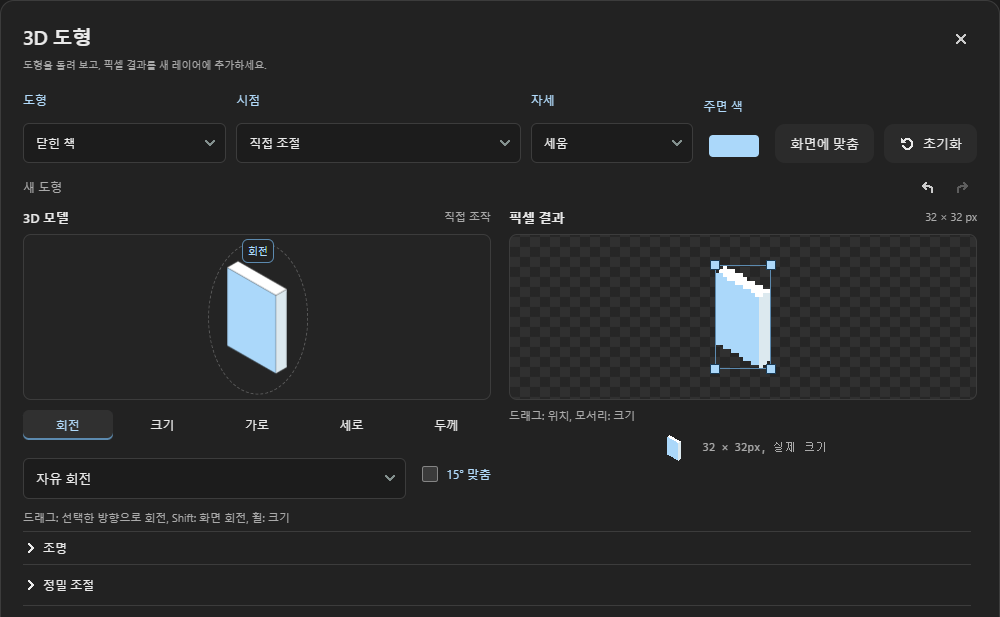
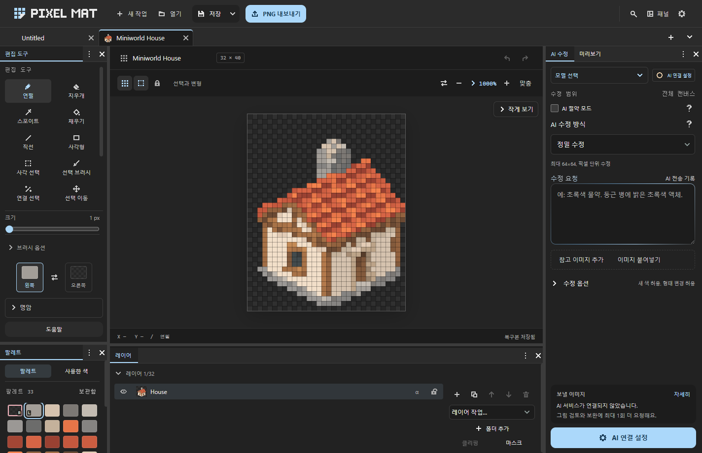
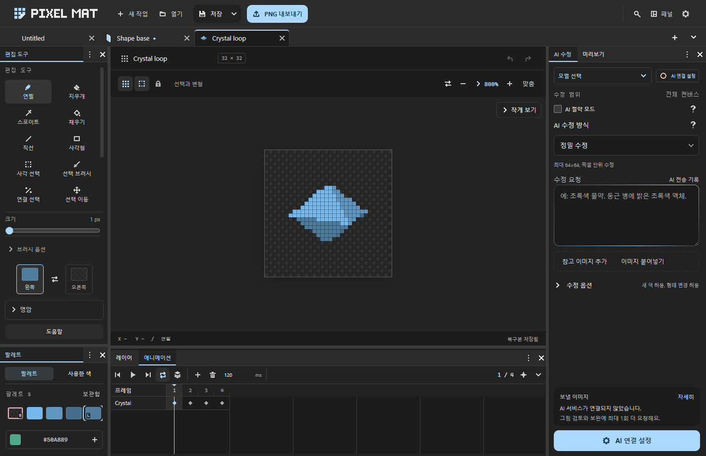
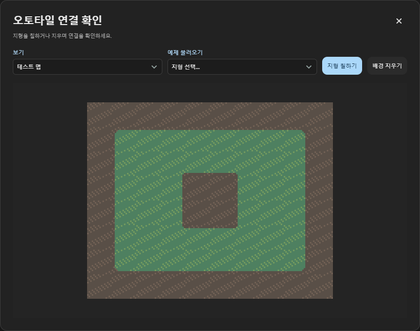

<a href="FEATURES.md">English</a> · <strong>한국어</strong> · <a href="FEATURES.ja.md">日本語</a>

<h1 align="center">Pixel Mat 기능 둘러보기</h1>

<strong>도형, 스케치, 기존 스프라이트에서 시작하세요. 베이스를 만들고 픽셀을 다듬어 게임 리소스로 내보냅니다.</strong>

Windows 베타 · 0.23.0-beta.2 · AI 스킬 + 픽셀 편집기

<a href="../README.ko.md#빠른-시작"><strong>설치하고 첫 결과 만들기 →</strong></a> &ensp;·&ensp; <a href="https://github.com/hjcud/pixel-mat/releases/tag/v0.23.0-beta.2">베타 다운로드</a> &ensp;·&ensp; <a href="EDITOR_GUIDE.md">편집기 안내</a>

<table align="center">
  <tr>
    <td width="420"><a href="#3d-도형으로-베이스-만들기"><strong>3D 도형 베이스</strong></a> 도형과 시점을 정하고 실제 픽셀 크기의 베이스를 만듭니다.</td>
    <td width="420"><a href="#픽셀을-그리고-정리하기"><strong>픽셀 드로잉과 레이어</strong></a> 선택, 팔레트, 편집 보호 기능으로 그림을 완성합니다.</td>
  </tr>
  <tr>
    <td><a href="#검토하고-적용하는-ai-수정"><strong>AI를 활용한 보정</strong></a> 참조를 전달하고 수정안을 비교해 적용할 결과를 고릅니다.</td>
    <td><a href="#스프라이트-애니메이션-만들기"><strong>애니메이션</strong></a> 프레임과 시간을 편집하고 시트·JSON·APNG로 내보냅니다.</td>
  </tr>
  <tr>
    <td><a href="#이어지는-타일-만들기"><strong>타일·오토타일</strong></a> 반복 무늬를 확인하고 Blob-47 지형 연결을 구성합니다.</td>
    <td><a href="#작업에-맞게-화면-구성하기"><strong>유연한 작업 공간</strong></a> 탭과 패널을 옮기고 팔레트를 재사용하며 작업을 복구합니다.</td>
  </tr>
</table>

## 3D 도형으로 베이스 만들기

책, 상자, 지붕처럼 쓸 삼각기둥, 피라미드, 보석의 기본 형태를 먼저 잡고 세부를
그릴 수 있습니다. 모델을 돌리고 가로·세로·두께를 조절하면서 목표 캔버스의 픽셀
결과를 확인하세요. 도형 베이스는 로컬에서 생성됩니다.

1. 편집 도구의 **3D 도형**을 열고 내장 도형 5종 중 하나를 고릅니다.
2. 시점을 선택하거나 모델을 드래그하고, 크기·주면 색·선택적인 조명을 조절합니다.
3. 결과를 새 레이어로 추가한 뒤 허용된 면 내부를 꾸밉니다.

가이드는 도형 매개변수와 면 경계를 보존합니다. 조작 창을 다시 열어 각도나 비율을
바꿀 수 있습니다. 자유롭게 칠하거나 프레임 애니메이션으로 만들 때는 가이드를
해제하세요. 도형 생성은 **각 변 8–64픽셀** 캔버스에서 지원합니다.

[32×32 도형 프로젝트 열기](product/examples/shapes.pixeltool) ·
[실제 크기 PNG](product/examples/shapes.png) · [단계별 사용법](EDITOR_GUIDE.md#3d-shape-bases)

GitHub에서 **Download raw file**로 받은 뒤 `.pixeltool`을 Pixel Mat에서 여세요.

## 픽셀을 그리고 정리하기

생성한 베이스를 완성하거나 처음부터 그릴 수 있습니다. 연필, 채우기, 선, 도형과
사각·타원·올가미·다각형·연결 선택을 사용하세요. 그룹, 레이어 마스크, 클리핑,
투명 잠금으로 원하는 곳에 수정을 제한하고, 정수 배율에서 그리면서 실제 크기
미리보기도 함께 확인할 수 있습니다.

프로젝트 팔레트를 재사용하거나 팔레트 보관함으로 색을 가져올 수 있습니다.
레이어와 편집 상태는 `.pixeltool`로 보관하고, 완성한 픽셀은 PNG로 내보내세요.
위 집은 별도의 Miniworld 예시입니다. [편집·파일 작업 안내](EDITOR_GUIDE.md#open-edit-and-export)

## 검토하고 적용하는 AI 수정

AI 호스트 안에서 스킬을 사용하거나 앱에 API 연결을 설정합니다. 참조 이미지는
전송 전에 살펴보고 자를 수 있습니다. 앱에서는 목표 해상도의 수정안을 비교한 뒤
적용하거나 버립니다.

| 작업 | 동작 |
| --- | --- |
| 정밀 수정 | 최대 64×64 범위의 수정 가능한 픽셀을 원래 격자에서 편집합니다. |
| 전체 수정 | 이미지 초안을 생성하고 로컬에서 변환합니다. 16×16의 기본값은 중앙 대표색이며, 영역 배정은 선택 가능한 베타 방식입니다. |
| 로컬 재변환 | 보관된 초안의 색·투명도 변환을 조절합니다. 추가 이미지 생성 요청은 하지 않습니다. |

활성 레이어, 선택, 팔레트, 투명 잠금, 마스크, 세부 보호 조건이 수정 범위를 제한합니다.
적용한 제안은 한 번에 실행 취소할 수 있습니다. 제공자에게 보내는 참고 정보에는 주변이나
다른 보이는 픽셀이 포함될 수 있으므로 [연결·데이터 처리](../DATA_HANDLING.md)를 확인하세요.

> 기존 팔레트로 랜턴만 밝게 바꿔 줘. 자세와 다른 픽셀은 유지하고, 적용 전에 수정안을 보여줘.

로컬 도구는 오프라인으로 작동합니다. AI 생성에는 본인 호스트 계정의 사용 한도나
API 크레딧이 쓰이며, 호스트 구독과 앱 내부 API 연결은 별도로 설정합니다.
[스킬 빠른 시작](../README.ko.md#스킬-사용) · [기록된 결과 비교](whole-comparison/README.md)

## 스프라이트 애니메이션 만들기

프레임을 복제하거나 추가하고, 각 셀을 편집하고, 재생 시간을 바꿔 반복 재생할 수
있습니다. 어니언 스킨으로 이웃 프레임을 비교하고 타임라인에서 프레임별 레이어와
그림을 관리하세요. 지원하는 AI 연결을 설정했다면 검토를 거치는 네이티브 움직임
계획도 요청할 수 있습니다.

이 예제는 **로컬에서 구성한 4프레임 반복 동작**입니다. AI 결과 품질을 보여주는
샘플은 아닙니다. 파일을 열어 속도나 그림을 바꿔보세요. 애니메이션 내보내기에는
PNG 시트, 프레임 위치·시간 JSON, APNG 미리보기가 포함됩니다.

[편집 가능한 클립](product/examples/crystal/project.pixeltool) ·
[스프라이트 시트](product/examples/crystal/sheet-1.png) ·
[프레임 JSON](product/examples/crystal/spritesheet.json) ·
[APNG](product/examples/crystal/preview.apng) · [애니메이션 안내](EDITOR_GUIDE.md#animation)

## 이어지는 타일 만들기

반복 타일 미리보기에서 맞은편 경계를 확인할 수 있습니다. 연결 지형은 내부·상하 경계·
좌우 경계·바깥 모서리·안쪽 모서리의 원본 5종을 편집하고, **Blob 47종과 배경 타일 1종**으로
조합되는 모습을 확인합니다.

연결 확인 창에서 테스트 맵을 칠하거나 지우고 아틀라스 보기로 전환하세요. 공유 경계를
보호하면서 편집 가능한 원본의 세부가 연결 타일에 반영됩니다. 이 예제에는 로컬에서
만든 단순한 절차적 질감을 사용했습니다.

[편집 가능한 타일 세트](product/examples/tiles.pixeltool) ·
[128×96 아틀라스](product/examples/tiles.png) · [타일 메타데이터](product/examples/tiles.json) ·
[타일 사용법](EDITOR_GUIDE.md#tiles-and-autotiles)

## 작업에 맞게 화면 구성하기

그림, 레이어, 팔레트, 미리보기, 애니메이션에 필요한 공간을 배분하세요. 패널을 합쳐
도킹하거나 띄우거나 별도 네이티브 창으로 분리할 수 있습니다. 문서 탭도 창 사이에서
옮길 수 있으며 문서마다 선택, 활성 레이어, 실행 취소 이력을 유지합니다. 상단 **패널**
메뉴에서 레이아웃을 초기화하거나 닫은 패널을 다시 엽니다.

| 함께 제공하는 기능 | 유용한 상황 |
| --- | --- |
| 팔레트 보관함과 색상 램프 | 여러 리소스에 같은 게임 팔레트를 적용할 때 |
| 단축키 설정과 미리보기가 있는 스크립트 도구 | 같은 편집 작업을 반복할 때 |
| 로컬 자동 저장과 복구 사본 | 작업 중단 후 복구 가능한 내용을 다시 열 때 |
| UI 언어 7종 | 한국어·영어·일본어·중국어·스페인어·프랑스어·독일어로 작업할 때 |

[작업 공간·복구 안내](EDITOR_GUIDE.md#workspace-and-recovery) ·
[사용자 도구·단축키](../CUSTOM_TOOLS.md)

## 필요한 결과물 고르기

| 파일 | 용도 |
| --- | --- |
| `.pixeltool` | 레이어, 가이드, 팔레트, 지원되는 애니메이션 상태를 보관하고 편집을 계속합니다. |
| PNG | 게임이나 다른 도구에 가져갈 실제 해상도의 합성 이미지입니다. |
| 스프라이트 시트 + 프레임 JSON | 프레임을 묶은 이미지와 좌표·시간 정보입니다. |
| APNG | 지원하는 이미지 뷰어에서 재생할 반복 동작 미리보기입니다. |

## 현재 베타의 범위

| 항목 | 현재 지원 범위 |
| --- | --- |
| 앱 배포 | 서명되지 않은 Windows x64 폴더 빌드 |
| 3D 베이스 | 내장 도형 가이드 5종, 각 축 8–64px |
| 애니메이션 | 메모리 한도 내 수동·가져온 클립 최대 128프레임. AI·네이티브 동작 계획은 2–24프레임, 최대 64×64 |
| 이미지 변환 | 크기와 색 수가 맞아도 얼굴의 닮음이나 작은 소품의 세부를 보장하지는 않음 |
| 실험 옵션 | 원본 분석·재구성, 원본 레이아웃·샘플링 평면, 영역 배정에는 별도 한계가 있음 |

[설치하고 첫 결과 만들기](../README.ko.md#빠른-시작) ·
[기법과 한계](TECHNIQUES.md) · [화면·예제의 출처](product/README.md) ·
[라이선스 범위](../LICENSE_SCOPE.md)
