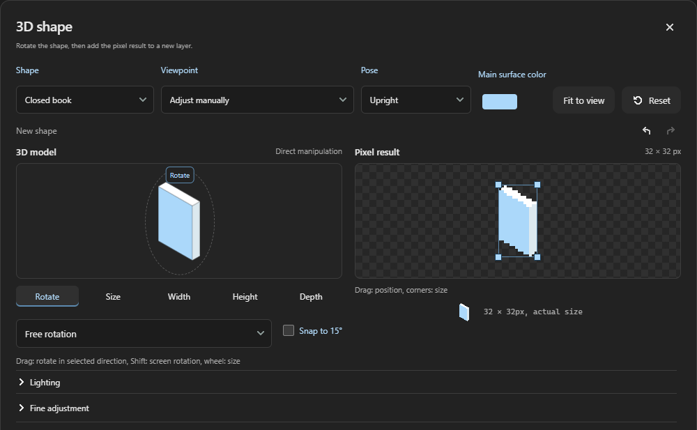
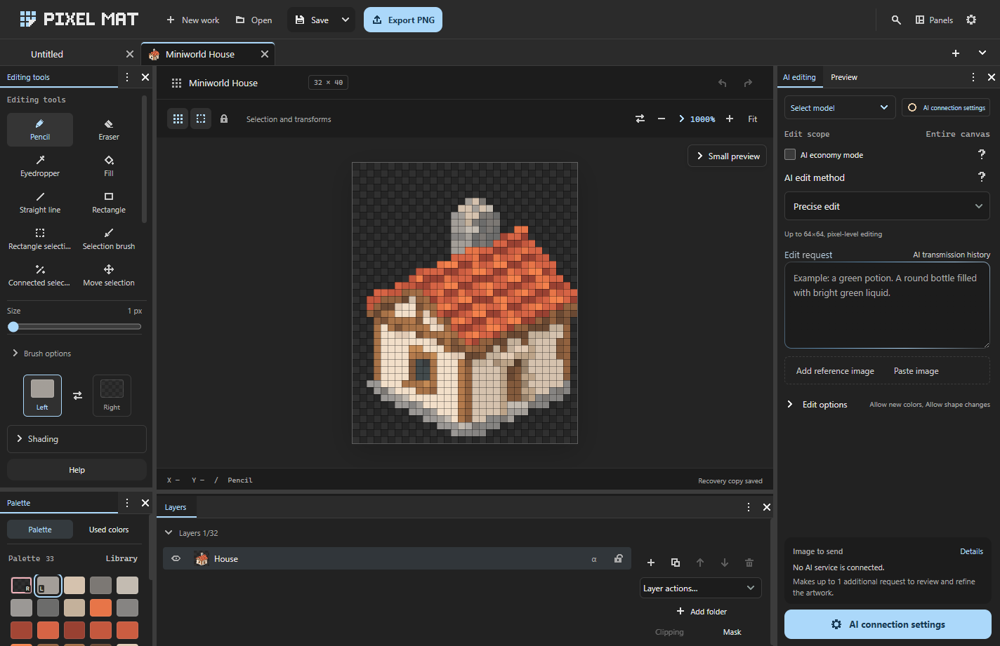
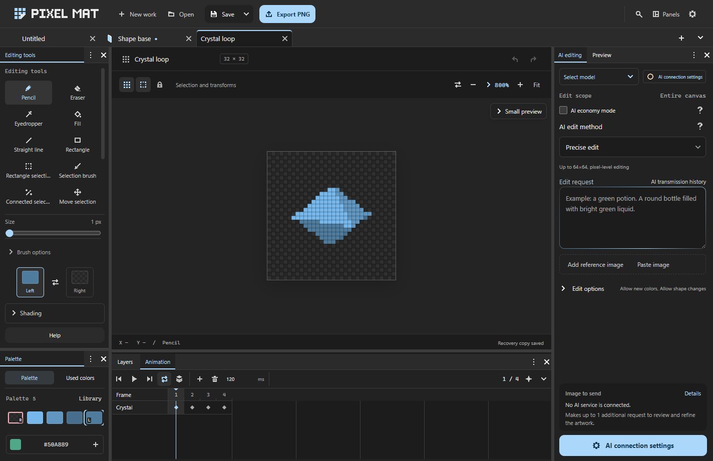
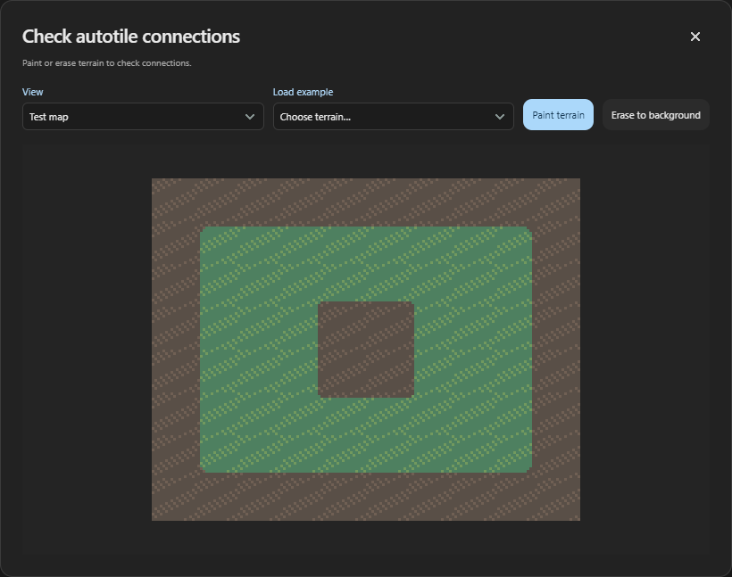

<strong>English</strong> · <a href="FEATURES.ko.md">한국어</a> · <a href="FEATURES.ja.md">日本語</a>

<h1 align="center">Pixel Mat Feature tour</h1>

<strong>Start with a shape, a sketch or an existing sprite. Build the base, refine the pixels and export game resources.</strong>

Windows beta · 0.23.0-beta.2 · AI skill + pixel editor

<a href="../README.md#quick-start"><strong>Install and try it →</strong></a> &ensp;·&ensp; <a href="https://github.com/hjcud/pixel-mat/releases/tag/v0.23.0-beta.2">Beta downloads</a> &ensp;·&ensp; <a href="EDITOR_GUIDE.md">Editor guide</a>

<table align="center">
  <tr>
    <td width="420"><a href="#start-with-a-3d-shape"><strong>3D shape bases</strong></a> Choose a shape and camera angle; get a native pixel base.</td>
    <td width="420"><a href="#draw-and-organize-the-pixels"><strong>Pixel drawing and layers</strong></a> Selections, palettes and protected edits for finishing artwork.</td>
  </tr>
  <tr>
    <td><a href="#ai-edits-with-a-review-step"><strong>AI-assisted refinement</strong></a> Use references, compare proposals and choose what to apply.</td>
    <td><a href="#assemble-a-sprite-animation"><strong>Sprite animation</strong></a> Edit frames and timing; export sheets, JSON and APNG.</td>
  </tr>
  <tr>
    <td><a href="#build-connected-tiles"><strong>Tiles and autotiles</strong></a> Check repeating textures and build Blob-47 terrain connections.</td>
    <td><a href="#make-room-for-your-work"><strong>A flexible workspace</strong></a> Move tabs and panels, reuse palettes and recover local work.</td>
  </tr>
</table>

## Start with a 3D shape

Block out a book, box, roof-like prism, pyramid or crystal before painting its
details. Rotate the model, change its width, height and depth, and inspect the
pixel result at the target canvas size. The shape base is generated locally.

1. Open **3D shape** in the editing tools and choose one of the five built-in shapes.
2. Choose a viewpoint or drag the model; adjust dimensions, surface color and optional lighting.
3. Add the result as a new layer, then decorate the permitted face interiors.

The guide retains shape parameters and face boundaries. Reopen its controls to
change the angle or proportions. Release the guide when you want unrestricted
painting or frame animation. Shape generation supports **8–64 pixels per side**.

[Open the 32×32 shape project](product/examples/shapes.pixeltool) ·
[Native PNG](product/examples/shapes.png) · [Step-by-step guide](EDITOR_GUIDE.md#3d-shape-bases)

On GitHub, use **Download raw file**, then open the `.pixeltool` in Pixel Mat.

## Draw and organize the pixels

Finish a generated base or draw from scratch with pencil, fill, lines, shapes and
rectangle, ellipse, lasso, polygon or connected selections. Groups, layer masks,
clipping and alpha locks help keep the edit where you intended. Inspect the
actual-size preview while working at an integer zoom.

Reuse a project's palette or import colors into the palette library. Keep
`.pixeltool` for layers and editing state; export PNG for the rendered pixels.
The house above is a separate Miniworld example. [Editing and file workflow](EDITOR_GUIDE.md#open-edit-and-export)

## AI edits with a review step

Use the skill inside your AI host, or configure an API connection in the app.
References can be inspected and cropped before submission. In the app, compare
the target-resolution proposal, then apply it or discard it.

| Task | What happens |
| --- | --- |
| Precise edit | Edit writable pixels within bounds up to 64×64, preserving the native grid. |
| Whole-image edit | Generate a raster draft and convert it locally; at 16×16, central median is the default and region allocation is an optional beta choice. |
| Local reconversion | Adjust the retained draft's color/alpha conversion without another image-generation request. |

Active-layer, selection, palette, alpha, mask and detail protections constrain
what can change. An applied proposal can be undone in one step. Context sent to
the provider can include surrounding or other visible pixels: review
[connection and data handling](../DATA_HANDLING.md) before using AI.

> Brighten the lantern using the existing palette. Keep the pose and other
> pixels, and show the proposal before applying it.

The local tools work offline. AI generation uses your own host allowance or API
credits; host subscriptions and in-app API connections are configured separately.
[Skill quick start](../README.md#use-the-skill) · [Recorded output comparison](whole-comparison/README.md)

## Assemble a sprite animation

Duplicate or add frames, edit each cel, adjust duration and play a loop. Onion
skin helps compare neighboring frames; the timeline keeps frame-local layers
and artwork together. You can also request a reviewed native motion plan through
the AI workflow when a suitable connection is configured.

This example is a **locally constructed four-frame loop**, not an AI quality
demonstration. Open it and change the timing or artwork. Animation export contains
PNG sheets, frame rectangles/durations in JSON and an APNG preview.

[Editable clip](product/examples/crystal/project.pixeltool) ·
[Sprite sheet](product/examples/crystal/sheet-1.png) ·
[Frame JSON](product/examples/crystal/spritesheet.json) ·
[APNG](product/examples/crystal/preview.apng) · [Animation guide](EDITOR_GUIDE.md#animation)

## Build connected tiles

Use the repeating-tile preview to inspect opposite edges. For connected terrain,
edit five source roles—interior, horizontal edge, vertical edge, outer corner and
inner corner—and inspect how they compose into **47 Blob variants plus a background tile**.

The workbench lets you paint or erase a test map and switch to the atlas view.
Shared boundaries remain constrained while editable source details propagate
to the connected variants. This demo uses simple local procedural textures.

[Editable tile set](product/examples/tiles.pixeltool) ·
[128×96 atlas](product/examples/tiles.png) · [Tile metadata](product/examples/tiles.json) ·
[Tile workflow](EDITOR_GUIDE.md#tiles-and-autotiles)

## Make room for your work

Give artwork, layers, palette, preview and animation the space they need. Dock
panels together, float them or detach them into native windows. Move document
tabs between windows; each document retains its own selection, active layer and
undo history. Reset or reopen panels from the header's **Panels** menu.

| Also included | Useful when… |
| --- | --- |
| Palette library and color ramps | Several assets need the same game palette. |
| Custom shortcuts and script tools with previews | You repeat the same editing steps. |
| Local autosave and recovery copies | You need to reopen recoverable work after an interruption. |
| Seven UI languages | You want to work in Korean, English, Japanese, Chinese, Spanish, French or German. |

[Workspace and recovery](EDITOR_GUIDE.md#workspace-and-recovery) ·
[Custom tools and shortcuts](../CUSTOM_TOOLS.md)

## Choose the output you need

| File | Keep it for… |
| --- | --- |
| `.pixeltool` | Continuing work with layers, guides, palette and supported animation state. |
| PNG | A native-resolution rendered image for your game or another tool. |
| Sprite sheet + frame JSON | Packed animation frames with coordinates and timing. |
| APNG | A loop preview that can be played by a supporting image viewer. |

## Current beta scope

| Area | Current scope |
| --- | --- |
| App distribution | Unsigned Windows x64 folder build. |
| 3D bases | Five built-in shape guides; 8–64px on each axis. |
| Animation | Manual/imported clips up to 128 frames within memory limits; AI/native motion plans use 2–24 frames and at most 64×64. |
| Image conversion | Native dimensions and bounded colors do not guarantee facial likeness or small-prop detail. |
| Experimental options | Source analysis/reconstruction, source layouts/planes and region allocation have separate limits. |

[Install and make a first result](../README.md#quick-start) ·
[Methods and limits](TECHNIQUES.md) · [Capture and example sources](product/README.md) ·
[License scope](../LICENSE_SCOPE.md)
