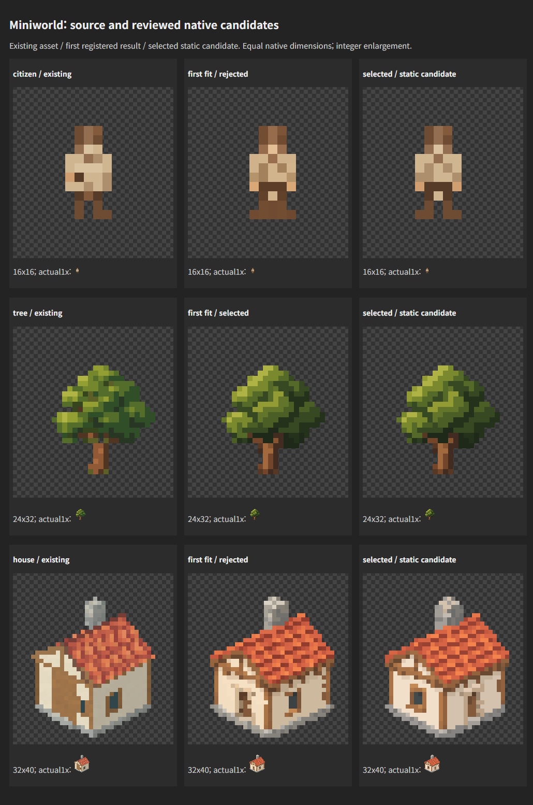
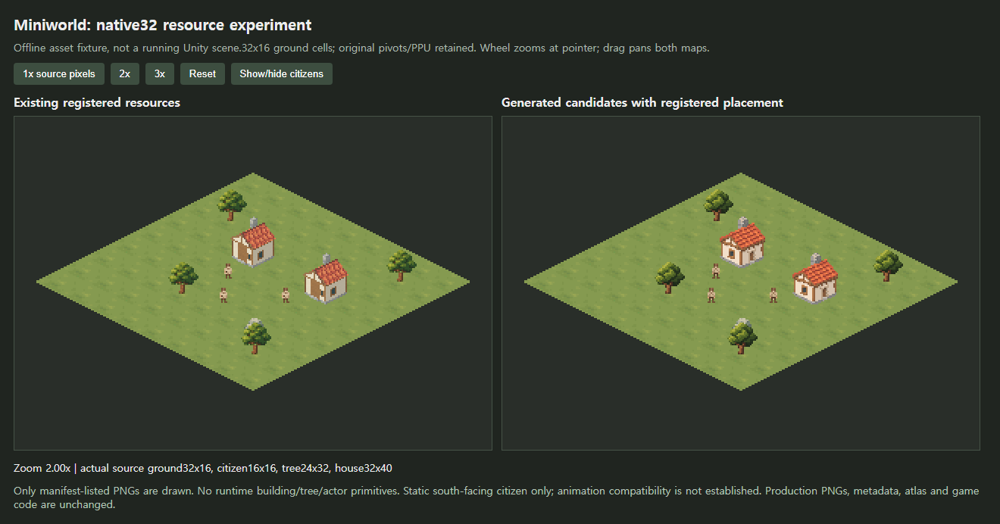

# Miniworld: from image drafts to registered native resources

Pixel Mat turns an image-tool draft into a constrained, editable pixel asset.
This case study uses three static Miniworld resources: a citizen, a tree and a
house. The useful comparison is **the recorded image draft before local
processing versus the reviewed native result**, with the existing game asset
shown separately as context. It is not a controlled “same GPT without/with a
skill” benchmark: the image model ID is unavailable, the drafts are reference
conditioned, and the old resources already include generation and processing.

Open the [comparison viewer](miniworld/index.html) for equal display areas,
integer enlargements, actual 1× native images, original draft links and editable
projects. The [public provenance ledger](miniworld/provenance.json) retains exact
prompts, reference relationships, SHA-256 fingerprints and measured properties.



## Contract before style

The inspected game uses 32×16 ground tiles and 16 pixels per unit. Its native
source scale of 0.5 and source-to-canonical factor of 2 are shared rendering
factors; they do not justify an additional actor enlargement. Pivots below are
pixels from the bottom-left. Candidate files preserve these canvas contracts.

| Resource | Raw image-tool draft | Native canvas | Pivot | Nontransparent RGBA colors: draft → selected |
| --- | --- | --- | --- | --- |
| Citizen, static south idle | 1254×1254 | 16×16 | 8, 3 | 10,836 → 8 |
| Tree | 1086×1448 | 24×32 | 12, 4 | 22,571 → 15 |
| House, complete south | 1122×1402, corrected draft | 32×40 | 16, 8 | 62,413 → 32 |

The color column counts distinct nontransparent RGBA values,
including partially transparent edge colors in the drafts. All selected native
PNGs have binary alpha. Color counts and valid dimensions measure constraints,
not artistic quality. The requested image-tool grids and color limits were not
the actual delivered raster dimensions or color counts.

## What produced the selected results

1. Inspect the registered game resources and use integer enlargements as image
   references. The retained experiment records four built-in image-tool calls:
   one citizen, one tree and two house drafts. The second house call corrects a
   door on the wrong visible wall. It is an additional model call, not a local
   converter repair.
2. Crop each actual draft at alpha threshold 128, preserve aspect ratio inside
   the baseline occupied bounds, sample native cells with Pixel Mat's feature
   sampler, fit a source-derived palette without dithering, and register lower
   support to the baseline datum. This uses a small experiment helper with the
   same deterministic modules shipped in the skill/app. Registration is an
   explicit helper step; the CLI's default frame fit does not perform it.
3. Review at native size and integer zoom. The citizen's first fit has joined
   feet and shifts the original head phase. A host-authored initial native
   proposal changes 46 cells: shift supported rows one pixel left, then clear
   two cells between the feet. The retained plan passes the shared atomic
   proposal validator with no changes outside its explicit mask. This initial
   experimental edit is not a bounded `refine` review and is not documented as
   human painting. Its exact mask, runs and source fingerprint are retained in
   [the edit plan](miniworld/citizen/native-edit-plan.json).
4. Keep every geometry/alpha cell fixed during final palette work. The citizen
   maps 15 opaque colors to its existing eight-color production palette. The
   house consolidates 63 opaque colors to 32 plus transparency. The tree keeps
   its registered 15-color result; the more compact palette flattened its leaf
   masses and was rejected. These choices require review and are not an
   automatic claim of quality improvement.

The earlier citizen baseline itself was a built-in image-tool native redraw
with registration. The tree baseline already used generated artwork, coverage
sampling and palette reduction; the house baseline already included editable
architectural corrections. Labeling those resources “unprocessed plain GPT”
would misrepresent their history.

## Local replay and what it proves

After building the skill with `pnpm build:skill`, run from the repository root:

```sh
node docs/miniworld/reproduce.mjs dist/skills/pixel-mat
```

The same script also accepts an extracted complete skill folder. It creates
temporary outputs outside the repository and makes no model requests. On
2026-11-22, **13 exact RGBA comparisons passed**: three current default CLI
conversions, three registered conversions, the citizen proposal, three final
palette selections and three saved-project reexports. The verification record
includes hashes of the built CLI and relevant runtime modules. Each selected
project also exported a byte-identical PNG through the built CLI.

The default CLI conversion is provided as an additional diagnostic in the
viewer. It differs from the custom registered selections. The replay reproduces
the recorded postprocessing from the retained drafts; it does not reproduce
image-model generation or establish that an agent automatically chooses the
same prompts, edits or preferred art. Retained historical frame-fit variants
used `structure`, while the current-default diagnostic explicitly uses
`features`. Do not conflate these routes.

No new live image generation, paid service, Unity write or production asset
replacement was needed for this publication package. Model ID, tokens and
generation cost are **unknown**. Four recorded calls are not a complete account
of the older baseline's generation history. Local processing uses no model
tokens; no total token-saving percentage is established.

## Placement fixture and remaining work



The 1×, 2× and 3× captures show a local PNG placement fixture using produced,
registered PNGs, including the unchanged grass and stone context. They are not
Unity runtime screenshots. The captured images themselves were inspected and
contain the artwork. Earlier blank `map-pass*` captures are invalid and excluded.

`readyForIntegration` remains **false**. Only one static south-facing citizen
is covered. Walk/idle coherence, other directions, damaged building states,
collider alignment, occlusion and Unity runtime acceptance remain untested.
The tree is a canopy variant; the house is a compatible architectural variant,
not proof of identical structural geometry. The miniature resident's minimal
face is not evidence of detailed portrait likeness at 16 pixels.

The selected Miniworld project resources are shown at the owner's request.
Their inclusion does not assert an independent redistribution license or
exclusive rights in generated images. See [license scope](../LICENSE_SCOPE.md).
Personal character-reference experiments, absolute local paths, account data,
credentials and chat identifiers are excluded from this public package.
