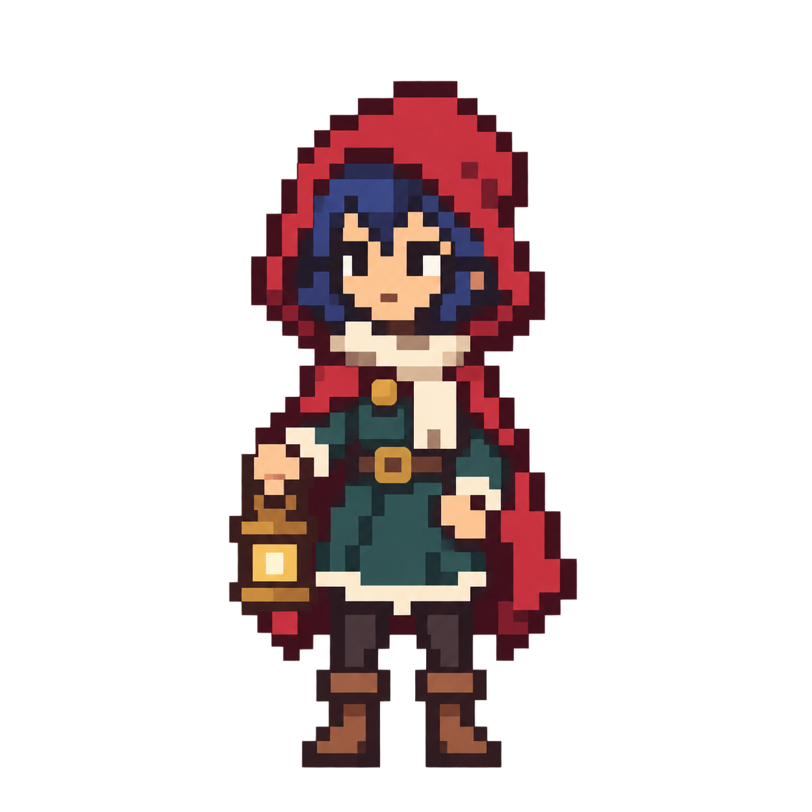
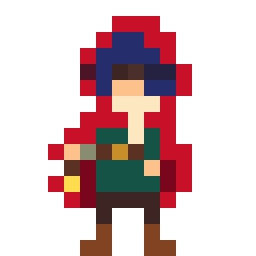

# Ordinary image request and Pixel Mat whole-image workflow

The current [same-user-prompt comparison](whole-comparison/README.md) uses a
complex red-hood character. Both actual requests explicitly ask for native
16x16 pixel art and at most 16 colors including transparency, with the same
reference. The ordinary output is preserved unchanged; the whole-image output
uses the 0.23.0-beta.1 central-median default and shared local conversion.

| Ordinary image request, fitted for display | Whole-image latest, exact 16x enlargement |
| --- | --- |
|  |  |

Actual 1x: .
Optional region-allocation beta: .

This demonstrates a usable native grid/palette/file contract, while expression
and lantern construction remain incomplete. There is one fresh model request
per condition, without cherry-picking a new draw. Generation uses the Codex
host tool; app API behavior is mocked in automated checks. This is not a verified
same-model benchmark or an observed ChatGPT website session. The exact common
prompt, product instructions, raw outputs, native projects and fingerprints are
retained in the [case-study package](whole-comparison/README.md).
